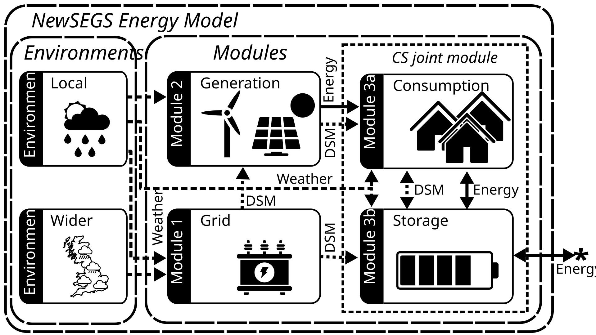

# The NewSEGS Model

## Introduction 
The North Wales Social Housing Newbuild on-Site Energy Generation and Storage (NewSEGS) project aims to identify and optimise opportunities for self-supply of renewable energy in newbuild social housing in North Wales.

The NewSEGS-modelling project builds on the work of Dr David Sprake to produce estimates of the financial performance of a local energy system.

## Getting Started

## Supported platforms
This program has been tested on the following platforms:

- Python 3.13 running on Microsoft Windows 10

## Installing dependencies
In order to run this model, it is recommended that you set up a virtual execution environment. Using conda or miniconda, it is recommended you do so from the relevant `conda-lock.yml` file using the command:

```
conda env create -f conda-lock.yml
```

There are a small number of `pip` dependencies that must be installed after creating this environment:

- apache-hamilton==1.90.0
- dash-ag-grid==35.3.0
- dill==0.4.1
- diskcache==5.6.3
- multiprocess==0.70.19
- mypy-extensions==1.1.0
- objprint==0.3.0
- py-spy==0.4.2 (Optional)
- typing-inspect==0.9.0
- useful-types==0.2.1
- viztracer==1.1.1 (Optional)

## Environment variables

It is suggested that the following variables are set in a .env file:

- PYTHONPATH = ./src
- PVLIB_USE_NUMBA = "1"

## Running calculations

**TODO**

## Model Concept

### Model Diagram


*NewsegsMetamodel conceptual diagram*

### Model description

A NewSEGS model does not exist in isolation - it exists in an ecosystem of components which may be divided into three categories:

1. Components which control the behaviour of the model.

1. Components which are dependent upon services provided by the model.

1. Components which are controlled by the model.

Before describing any particular component in detail, let us consider these three categories.

#### Model controlling components

Model controlling components can be considered as existing *outside* of the model. There is one key component fitting this description - the **Metamodel**. This is described in detail in its own section, but in brief the Metamodel serves two primary purposes:

1. Providing an encapsulation for everything that a user might consider to be a "configuration" - i.e. the model, its parameters, the current financial assumptions, and metadata associated with the configuration (i.e. its name and nominal location).

2. Holding data relevant to model analyses but outwith a single model run - e.g. statistics for parametric uncertainty (used for probabilitic sensitivity analysis (PSA) or setting plausible bounds for deterministic sensitivity analysis (DSA)), or settings for these sensitivity analyses, as well as providing keys for retrieval of results of these analyses.

To accomplish this, in addition to the Model itself, the Metamodel contains a **Finance** model, and a list of **Variable**s, described latterly.

#### Components dependent on services provided by the Model

There is only one clearly dependent component within the overall Newsegs Metamodel structure - the **Finance** model. This component uses the configuration parameters (e.g. deployed generation capacity) and timeseries results (e.g. site export meter values) in order to calculate financial timeseries and statistics from the model run. Due to this tight coupling, the Finance model contains a reference to its associated (energy) Model, as well as the association provided by its containing Metamodel.

Components within the Model are also dependent upon services provided by the Model, but the Finance Model stands apart as it is considered sufficiently independent as to be capable of interchangeability with other Finance Models without necessitating a re-run of the Model; whilst this is technically true for independent *Modules* within the Model, to allow for tighter coupling of the modules in future (e.g. should dynamic curtailment of generation be introduced in response to local grid conditions) this partitioning was considered appropriate.

Downstream processes may also be dependent upon Model services; however, these can be considered ancilliary to the main Metamodel structure and are not described here.

#### Components controlled by the Model

These components can be divided into two groupings:

1. Components serving data requested by other components, mediated by the model (**Environment Servers**).

2. Components computing timeseries of energy generation and transfer, and/or timeseries of control signals, dependent upon parameters and served environmental data (**Modules**).

The behaviour of these components is elaborated on in further sections, but it is worth providing an initial outline of the purpose of each of them.

The **Local Environment Server** provides timeseries (or constant) environmental (weather) data relevant to conditions at the NewSEGS site - e.g. energy flows relevant to electrical generation and passive space heating / cooling (e.g. wind speed, solar insolation flux on inclined or horizontal planes, air pressure, air temperature), and conditions relevant to heat transfer over the building envelopes (e.g. air temperature, wind speed).

The **Wider Environment Server** provides timeseries (or constant) environmental (weather) data relevant to estimating the spot price of electricity or the probability of a demand side management event occuring. This may be, for instance, the air temperature averaged over multiple sites in GB, or low wind speeds / insolation in the south of GB.

The **Grid Module** uses data provided by the Wider Environment Server in order to provide signals indicating the relative value/cost of site exported/imported electricity; it also provides signals for forecasts of these values and costs. Presently, there are no other modules capable of using these signals, and so a concrete implementation of a Grid Module providing non-constant price signalling has not yet been developed. Further development of the Grid Module may produce signals based on local environmental data, which may be used to determine periods during which local generation or storage would be required to disconnect from the local grid to protect it from a high quantity of uncontrolled distributed generation.

The **Generation Module** uses data provided by the Local Environment Server in order to provide metered values of exported (and/or consumed) electrical energy from on-site generators. "Forecasting" generation modules may use a modified form of future local environmental data in order to form predictions of upcoming generation, and so provide a DSM signal which may inform consumption or storage patterns (a simple implementation might be a signal showing the current capacity factor, which may be used to trigger delaying or advancement of some loads in the consumption module).

The **Consumption and Storage (CS) Module Group** consists of a pair of tightly-linked modules. Control of the NewSEGS scheme is assumed to be primarily by charging and deployment of (an) electrical energy storage device(s); however, in the simplest schemes it is assumed that control is achieved by measurement of energy flow over the boundary of the site alone, with the controller modifying the rate of charge/discharge of the battery to minimise this flow. As such, it is only the net production or consumption of the site that the controller is reacting to; i.e. in the null condition (no charge/discharge), the controller only meters the resultant energy flow after the on-site consumption has been taken from the on-site generation. For this reason, energy data from the Generation module is considered to pass through the Consumption module first, though a DSM signal may be passed to the Storage module for more advanced control with awareness of the absolute rates of generation and consumption.

The tight interlinking of the modules is necessary as the Storage module may produce demand-side-management signals which would impact the rate of consumption based upon its current state of charge, which itself (generally) dependent upon the rate of consumption.

Both modules use data provided by the Local Environment Server. For the Consumption module, this may impact electrical energy consumption due to environmental offsetting/incurring of energy requirements - e.g. additional requirement for space heating on days with low air temperature; lower lighting requirements in the summer; lower tumble drier use in periods of dry weather. For the Storage module, this may impact the capacity, charge/discharge rate, or lifespan, of the energy storage device.

Ultimately, the Storage module determines the quantity of electrical energy passing over the boundary to the NewSEGS site. The wider electrical grid is assumed an infinite bus, capable of absorbing any quantity of electrical energy provided to it and providing any quantity of electrical energy demanded from it.

#### Model results

The Modules of the Model produce timeseries of electrical energy (meter) data and other data relevant to control of the system, such as the state of charge of the storage device(s), referred to as "DSM" signals. These are served by the Model to other processes, which may post-process them.

The Finance Model component is a consumer of these data which exists within the purview of the Metamodel. By applying price values to the energy flows, purchasing and installation of generation, storage and metering equipment, and ongoing operation and maintenance costs, the Finance Module converts the results into Costs and Benefits from the perspective of the owner of the Generation and Storage system.

Sensitivity Analyses (DSA, PSA) produce Model and Finance Model results under varying parametric conditions. Some aggregated values of these results are stored for comparison.

Having outlined the overall structure of the NewSEGS model ecosystem, the following sections will describe in more detail the structure and behaviour of each component.

## Model Components

### Energy Model (The "Model")


*NewSEGS Energy Model block diagram*

The NewSEGS Energy Model (Model) consists of four calculation Modules, of which the latter two form a short-interval feedback loop and must be evaluated together.

- **Module 1 - Grid**
- **Module 2 - Generation**
- **Module 3a - Consumption**
- **Module 3b - Storage**

These four modules must be defined for a coincident time period, as one of the key considerations of the model is that short-term local environmental conditions determine the value of both generation and consumption, and may impact storage performance; correlated wider environmental conditions determine the cost of imported energy from the grid, and the sale price of electricity to the grid.

In order to provide for this requirement, a `NewsegsModel` is a container holding an instance of the first two calculation modules, and an instance of the consumption/storage joint calculation module, whilst providing an interface for access to environmental data.

#### Grid Module

- Requires: Wider environmental data
- Provides: Relative price of energy for input to or export from the site; Calls for bids for market participation; Indicators for grid access constraints.

The grid module represents the dynamics of the wider electricity supply; in particular, providing relative pricing signals for import and export, and signalling for participation in balancing markets. It is assumed to be dependent only on wider environmental conditions influencing the magnitude and location of power flows over the GB electrical transmission network and the consequent constraints at grid supply points; i.e. the site as a point load or generator is assumed to have no influence over the bulk electricity trading conditions.

Due to this constraining assumption, the grid module may be run *in isolation* of the other calculation Modules and forms the head of the calculation chain.

Grid modules *may* be used to indicate dynamic network access constraints, e.g. indicating congestion at the local primary substation requiring a reduction in export capacity from the site. This information may be used by the generation module to constrain generator performance. This would be undertaken under the assumption that such constraints would be necessary regardless of on-site demand for grid safety; i.e. should the export capacity of the site be limited to 100 kVA, then the sum of generation and storage export power for the site should be dynamically configured to not exceed this in the case of a sudden (faulted) disconnection of the onsite load.

#### Generation Module

- Requires: Local environmental data, (Optional) Grid module results
- Provides: Electrical energy passing over various points on the local electrical grid, e.g. net export to the local microgrid grid within a timestep.

The Generation Module represents non-dispatchable generation on the local microgrid. This generation is assumed non-dispatchable beyond pre-defined responses to model time, local environmental conditions, and local grid conditions. It is not necessary that all generators be responsive to all of these inputs, and operation without indicator of local grid condition should be possible (i.e. under the assumption of no dynamic constraint on import/export capacity).

Due to the optional use of Grid Module results, this Module should be run second; however, in many cases, the results may be independent of the Grid module and would not be made invalid by changes to the configuration of the Grid module.

#### Consumption Module

- Requires: Local environmental data, (Optional) Grid Module results, (Optional) Generation Module results, (Optional) Storage Module results-to-date.
- Provides: Electrical energy demand by end consumers; passed-through Generation Module data

The Consumption Module represents residential electrical demand (including for space and water heating) on the local microgrid. This demand is assumed to be impacted by model time including time of year, day of week, holiday status, and daylight savings time. It is also assumed to be impacted by local environmental conditions; in particular, the local air temperature and solar irradiation; the first of which may impact space heating demand and the latter both space heating and lighting demand.

In some consumption modules, aspects of consumption may be deferred in time in response to demand-side management measures. Indication that these measures may be of value may be provided from the Grid Module, the Generation Module, or the Storage Module. As such, the Consumption Module should be run after the Grid and Generation Modules, and simultaneously with the Storage Module.

#### Storage Module

- Requires: (Optional) Grid Module results, Generation Module results, Storage Module results-to-date.
- Provides: Electrical energy import and export over site boundary; Electrical energy in storage; Electrical energy losses through storage.

The Storage Module represents the storage of electrical energy on site and its charging and dispatch. A typical application might be a site-scale battery energy storage system (BESS). It may be controlled considerate of the following parameters:

- Model time
- Current state of charge
- Current relative price of site electricity import/export (provided by Grid Module)
- Forecast relative price of site electricity import/export (provided by Grid Module)
- Current on-site generation status (provided by Generation Module)
- Forecast on-site generation status (provided by Generation Module)
- Current on-site consumption rates (provided by Consumption Module)
- Forecast on-site consumption rates (provided by Consumption Module)

It provides the rate and quantity of electrical import and export over meters around the site; in particular, the point of common coupling with the local distribution network. In a simple controller configuration, the storage module may be set to always charge at a rate equal to the net generation of site electricity after removal of on-site consumption and discharge at a rate equal to the net consumption of site electricity after removal of on-site generation, until saturation of the available storage capacity. More complex strategies may involve import of electricity during periods of low variable pricing and export during periods of high export pricing.

As the control logic for the storage may be dependent upon the state of all of the other computational Modules, it must be run subsequent to the Grid and Generation Modules and simultaneously with the Consumption Module. 

#### Environment Servers

As well as the four Modules, the Model provides access to environmental data through dedicated Environment Server objects. These are currently bound to the Model, in order that they can request data such as the computational timestep when responding to a data query; future development may alter this relationship such that a single server may service multiple Models.

#### Local Environment Server

This component provides environmental data for specified [location](#location) (dependent on this measure, this may require elevation and facing information) and [time periods](#timespan). A Local Environment Server is capable of providing the following timeseries data:

- Wind speed (m/s) at point location with positive height above ground level (AGL).
- Air density (kg/m³) at point location with positive height AGL.
- Horizontal solar flux (W/m²) at point location at ground level.
- External air temperature (°C) at point location at nominal height AGL.
- Solar flux on an inclined plane (W/m²) at point location with positive height AGL and specified azimuth and pitch.

The reference timeseries served may not correspond with the Model dates; e.g. the Model may request data into the future, or otherwise beyond the domain of the environment server, in which case the server may recycle prior data. In order to maintain synchronisation between weather time series, the server also provides access to the true datetimes of the reference timeseries for the requested timespans.

#### Wider Environment Server

This component provides environmental data for specified [time periods](#timespan) relevant for prediction of electricity prices to and from GB suppliers. It is capable of providing the following timeseries data:

- Temperatures (°C) at key weather stations over Great Britain.
- Horizontal solar flux (W/m²) at key weather stations over Great Britain.

The reference timeseries served may not correspond with the Model dates; e.g. the Model may request data into the future, or otherwise beyond the domain of the environment server, in which case the server may recycle prior data. In order to maintain synchronisation between weather time series, the server also provides access to the true datetimes of the reference timeseries for the requested timespans.

### Finance Model

The NewSEGS Finance model (Finance) transforms the configuration and results of a previously `run` NewSEGS Energy Model into financial values and statistics relevant to comparing the performance of NewSEGS schemes from the perspective of a System Owner (SO).

#### Perpectives

There are a number of perspectives that can be considered for cost-benefit analysis (CBA) of a NewSEGS scheme.

##### System Owner

The System Owner (SO) perspective encapsulates the generation, storage, distribution, metering, energy purchase and resale aspects of the scheme and is conceptually easy to value, as the majority of aspects have a direct monetary cost and the majority of benefits are also direct.

**Costs**

- Generation
    - One-off costs of planning
    - Capital cost of equipment
    - One-off or ongoing costs of site leases
    - One-off costs of installation and commissioning
    - Ongoing costs of operation and maintenance
    - Periodic costs of replacement or decomissioning
    - One-off costs of environmental impact mitigation
    - Ongoing costs of environmental impact mitigation
- Storage
    - One-off costs of planning
    - Capital cost of equipment
    - One-off or ongoing costs of site leases
    - One-off costs of installation and commissioning
    - Ongoing costs of operation and maintenance
    - Periodic costs of replacement or decomissioning
    - One-off costs of environmental impact mitigation
    - Ongoing costs of environmental impact mitigation
- Distribution
    - One-off costs of planning
    - Capital cost of equipment
    - One-off costs of installation and commissioning
    - Ongoing costs of operation and maintenance
    - Periodic costs of replacement or decomissioning
    - One-off costs of environmental impact mitigation
    - Ongoing costs of environmental impact mitigation
- Metering and Billing
    - Capital cost of equipment
    - One-off costs of installation and commissioning
    - Ongoing costs of operation and maintenance
    - Periodic costs of replacement
    - Ongoing costs of meter reading and billing
    - Ongoing costs of customer service
- Electricity purchase
    - One-off costs of site connection planning
    - One-off costs of site connection installation and commissioning
    - Periodic cost of access to supply
    - Variable periodic cost of electricity consumed
    - Variable periodic cost of power factor compensation
    - Periodic cost of contract (re)negotiation
- Electricity market participation
    - One-off costs to enrol in relevant markets
    - Periodic cost to administer market participation and control storage charging/dispatch

**Benefits**
- Residential sales
    - Periodic revenue from fixed (standing) charges
    - Periodic variable revenue per unit electricity sold
- Export sales
    - Periodic variable revenue per unit electricity sold
    - Periodic variable revenue per unit capacity provided (capacity markets)
- Residuals
    - Value of generation equipment
    - Value of storage equipment
    - Value of distribution equipment
    - Value of metering equipment
- Grants
    - Grants for installation of renewables on social housing

The quantity of residential sales is not necessarily fixed for a site under fixed environmental conditions; there may exist "rebound" effects tending to increase the quantity of electrical energy units used in response to a decrease in unit price or perceived reduction in environmental cost for each unit produced. These effects may be nonlinear, time-varying and subject to saturation points; e.g. resident behaviour changing to demand a higher mean internal temperature of their household in response to lower energy prices will have a hard threshold at a temperature beyond which any increases would become uncomfortable, and a soft threshold at a temperature beyond which any increases have no effect on comfort (i.e. the bounds of the "Goldilocks zone"). Changes in residential consumer behaviour will almost always result in a change to the marginal price of electricity supplied, as the proportion of imported versus on-site generated energy, and the quantity of energy available for export, will vary, even if the generation and storage scheme is varied proportionally due to the variable nature of the generation resource and the non-uniform application of the demand rebound.

The rebound effect, whilst being complex, is capable of representation within the NewSEGS model.

##### Resident

The Resident perspective considers only the consumption of electricity within the site. It does not encompass other costs of accommodation, including rent, as there is not a feasible mechanism whereby benefits accrued by the SO can be translated directly into rent corrections; i.e. all other costs are assumed fixed.

The primary benefit of a NewSEGS scheme to a resident is the supply of electrical energy. Under the assumptions of this model, this supply is invariant regardless of generation and storage composition or electricity market participation. In addition, it is assumed that there is no impact on any other benefit to the residential consumer, such as:

- Reliability of supply.
- Efficacy and flexibility of billing and payment.
- Provision of customer service.
- Ethical benefits from participation in a community-level low-carbon energy project.
   
Therefore CBA from the resident perspective cannot be fully defined and is a simple problem of cost minimisation, which may be achieved through two vectors:

- Reduction in residential demand
- Reduction in fixed and/or variable costs of supply

Reduction in demand can itself be achieved through changes to multiple factors, such as:

- Behavioural (i.e. energy intensity of occupation)
- Occupational (i.e. quantity of building-time occupied)
- Appliance (i.e. reduction of energy intensity of tasks through equipment)
- Building fabric (i.e. reduction of energy intensity of occupation through reduced heat loss/gain)

At least a proportion of all of these factors can be influenced by actions of the Landlord; however, the costs incurred by such action at not encapsulated within the Resident perspective. The costs of Resident actions to reduce demand are considered out of scope for the NewSEGS model, though they may have an impact on the marginal cost of electricity under a NewSEGS scheme, which may be reflected in the price of electricity to the residents after mediation by the SO. As these actions are not costed, from the Resident perspective within this model, demand modifying changes cannot be considered part of any optimisation problem.

Reduction in fixed and/or variable costs of supply are determined by the pricing structure and valuation of supply from the SO. Dependent on the financial requirements of the SO, these may be more or less decoupled from the marginal cost of supply to the SO; however, in the limit of minimum cost to the resident, price will be set to cover this cost only.

Therefore, within this model, optimisation of the NewSEGS system for cost minimisation to the resident requires minimisation of the cost to the SO of supply to residents. The problem is therefore best tackled from the SO perspective. After optimisation and assuming no further price-responsive changes in demand, the final cost to residents can be determined by choosing price values that satisfy the minimum financial requirements of the SO.

##### Landlord

The Landlord perspective considers the costs and benefits associated with the building assets and rent. The Landlord may also be SO, but even if they are not, the value of the NewSEGS scheme to the SO might be expected (under ideal competitive scenarios) to be reflected as a benefit to the Landlord through the price of compensation to the landlord; e.g. the price of the lease for generation siting.

Registered Social Landlords (RSLs) do not operate within an idealised competitive environment. Rent cannot increase and decrease in response to resident competition for residences, demand exceeds supply such that less desirable residences are not less valuable due to lower occupancy, and geography is not a commodity, so it is impossible to consider residences fully exchangeable. As such, it is a challenge to incorporate the Landlord perspective in a CBA without making substantial assumptions.

**Costs**

- Buildings
    - One-off cost of materials for construction
    - One-off cost of labour for construction
    - Ongoing cost of maintenance
- Appliances
    - One-off cost for purchase
    - Ongoing cost of maintenance
    - Periodic cost of replacement
- Administration
    - Ongoing cost of support of residents interacting with NewSEGS

**Benefits**

- NewSEGS value
    - Via lease or directly from net revenue
- Rent
    - Successfully paid rent (not modelled)
- Grants
    - Grants for energy-efficient building

The quantity of successfully paid rent might be considered to be influenced by several factors:

- Resident income
- Resident cost of living (including energy costs)
- Occupancy (number of units, proportion of units occupied - itself dependent upon demand level for property types in a location, and the turn-around time for a property which may partially depend on its ease of maintenance)

This model is principally concerned with the second factor, though the potential impact of any modelled technologies on the third should be considered. Reductions to the resident cost of living may be achieved by improvements to the building fabric or appliances (at cost to the landlord) or lower pricing of electricity supply, which may be achieved by lowering the marginal cost of supply, or reduction in the operating margin of the supplier and thus profitability of the SO.

However, the response of the proportion of rent successfully paid is expected to be highly non-linear in response to changes in the cost of energy at an individual household level, with a strong threshold effect between the rent being considered "affordable" and "not affordable". The impact of the NewSEGS scheme on the quantity of successfully paid rent is not modelled.

In the absence of this dependent variable, the only aspects determining the financial performance of the NewSEGS scheme from the perspective of the Landlord are the costs of building, the profitability of the SO, and any grants that might be incurred.

Less efficient buildings with higher energy requirements will tend to scale the profitability of a NewSEGS scheme to a SO provided that there is space available, grid access, and regulatory permission for sufficient generation and storage; i.e. if a small scheme is already profitable, then provision of a greater quantity of electricity to demand within that captive market will increase profitability. This may not always be true if the demand increases occurs disproportionately at times when the generation/storage system is not providing energy or if generator or storage cost does not increase linearly, but may be considered an approximate rule-of-thumb.

Therefore, it can be seen that under this framework, the Landlord perspective contains a perverse incentive to lower building costs by decreasing the energy efficiency of the buildings, which is then subject to a positive reinforcement by increasing value to the SO (and therefore the landlord) of supply of a greater number of units of electricity to residents. The effect of this on residents does not feed through to the Landlord under the present assumptions.

Even if they were, due to the expected nonlinearity in the rent payment response, an optimal system from the Landlord point of view would be one in which all tenants were spending their individual maximum possible amount on rent and energy.

It should therefore be considered that there are other non-monetary incentives and benefits to lowering the cost of living for tenants, not least the social obligations of a RSL.

To avoid these perverse incentives, the Landlord perspective is not to be considered a traditional Benefits-Cost opimisation problem. Rather, an appropriate problem to solve would be:

>  "What is the most cost-effective way for a Landlord to achieve a specified cost of energy for its tenants?"

As an example, a target level of affordability may be to consider buildings constructed to Passivhaus standard being supplied by regulated domestic electricity suppliers on standard tariffs. If the Landlord was to instead construct to a lower insulation standard, then tenants would be subject to higher energy costs, but a NewSEGS scheme could be used to supply electricity at a rate low enough to negate the difference. A cost-effective NewSEGS scheme at this rate would be self-sufficient and could attract funding if presented to a suitable SO; if not cost-effective, then the Landlord would have to part-fund the scheme, returning their costs towards or above the level of building to the higher insulation standard, in order to maintain the same level of energy affordability for their tenants.

###### Example of resident affordability threshold analysis

*Please note that these numbers are indicative only, using a generic site composition and resource profile*.

Consider a site of 50 units, with mean GFA of 90 m² and mean heat loss parameter (HLP) of 0.3 W/m²/K. Over ten years, it is estimated by the model that these consume 3,463,550 units of electricity at a cost of £1,101,755 from registered domestic suppliers. There is no generation or storage on site.

If instead the units were built to a HLP of 0.8 W/m²/K, the consumption would increase to 4,718,337 units and costs would increase by 36% to £1,500,900. By applying a discount of 26.5% (i.e 1 - 1,101,755/1,500,900) to electricity sold on site, costs to residents will return to £1,101,755, but the SO would have to cover that cost - assuming that the discount also applies to EV charging prices, then the undiscounted NPV to the SO decreases to -£410,312.

From a simple financial perspective to this limited ten-year horizon, if the money saved by the Landlord by building to the 0.8 HLP standard instead of the 0.3 standard exceeds £8,206 per unit, then they could take that money, fund the SO to make-up the difference in energy bills, and still be in profit; however, after the ten years have expired, they still have lower standard housing stock, and their tenants will continue to require subsidy to keep energy bills at the existing level.

A more sustainable alternative would be to invest in self-generation instead; investment in a 300 kWp solar array and 466 kWh BESS might increase the NPV to -£128,283, reducing the necessary subsidy to £2,566 per housing unit over the first ten years, assuming that the Landlord receives full SO benefits. However, this relatively high NPV does come at the expense of increased capital expenditure - approximately £480,000 for the generators and BESS (the majority of which for the PV generators, which would cover only 17.5% of winter consumption, but 94.5% of summer consumption), or £9,600 per housing unit; a higher lump-sum than the £8,206 spread out over ten years required for the without-NewSEGS project, and still requiring £2,566 per housing unit over ten years additional subsidy.

As a general rule for renewable energy generators, once installed, it is cost-effective to keep them running until maintenance costs become prohibitive, as the economics of them are dominated by the up-front cost and the marginal cost of generation is virtually nil. Therefore, up to the lifespan of the generator, increases in financial time horizon will tend to increase the NPV of a generation project. "Subsidy" of supply with active generation may therefore be considered just another aspect of project finance from this perspective, provided that a positive NPV occurs when considering a horizon of the project lifetime. Sale of electricity at heavy discount can occur, even if that electricity has had to be purchased at a higher rate, under the assumption that future profits will recoup these losses. For this reason, the system is sensitive to assumptions regarding discounting the future value of benefits or costs.

The low marginal cost of generation suggests that almost any level of price discount could be sustained provided that the equipment lasts long enough and maintenance is cheap enough. If the sale price to residents drops below the sale price to the grid, then this does not necessarily imply any great change in the system control strategy - the SO will incur large losses whenever it has to import electricity to sell at the heavily reduced rate, and so self-consumption is always preferred.

Practically, however, the limited lifespan of project assets and the dimishing future value of money does impose a relatively high limit on the lowest possible price for supply under a NewSEGS scheme.

Under the assumption that PV may be installed at a rate of £1,365 / kWp (see the initial site report and [Department for Energy Security and Net Zero](https://www.gov.uk/government/statistics/solar-pv-cost-data)) with ongoing costs 1% of initial costs per year and a mean capacity factor of 12% over a lifetime of 25 years and ignoring inverter replacement, the mean sale price of electricity could not be below £0.06493 for break-even; with a 3.5% discount rate, this increases to £0.08911. If requiring pay-back within 10 years, a mean price of £0.1428 is required, or £0.1638 with 3.5% discounting for both costs and benefits. These latter numbers are substantially greater than the expected sale rate for site exports, making storage particularly valuable for PV as peak production rarely occurs with peak consumption.

For small/medium scale wind, assuming a cost of £5,400 per kW of installed capacity (see the initial site report and [Energy Saving Trust 2024](https://energysavingtrust.org.uk/advice/wind-turbines/)) with ongoing costs 4% of initial costs per year and a mean capacity factor of 25% over a lifetime of 25 years, the mean sale price of electricity could not be below £0.1973 / kWh for break-even, and with a 3.5% discount on both costs and benefits, this increases to £0.2432 / kWh, higher than the target residential price in our HLP = 0.8 example. Under a 10 year horizon, payback requires £0.3452 / kWh, or £0.3851 / kWh with discounting at 3.5%. This is substantially higher than the price of electricity available from public supply; even with perfect storage capable of ensuring that all wind generation was consumed on site (by default, a higher proportion than PV due to the correlation of generation and load, but still imperfect) it would not have achieved payback within ten years if selling with *no* discount to the residents.

What this implies from the Landlord perspective is that trading between energy efficiency and NewSEGS project value is not unlimited or without compromise.

- High insulation, no NewSEGS:
    - Higher one-off costs to Landlord for building.
    - Low level of consumption by residents, but high per-unit cost, resulting in moderate energy costs. Asymptotic lower limit to consumption due to appliance, hot water, lighting use.
    - No one-off costs for SO for generation/storage construction.
    - No ongoing costs for SO.
    - High residual value of building due to fabric quality.
    - No residual value of NewSEGS.
- Low insulation, no NewSEGS:
    - Lower one-off costs to Landlord for building
    - High level of consumption by residents, but moderated per-unit cost, financed by savings from building but with no long-term recovery mechanism and with potential to exceed savings.
    - No one-off costs for SO for generation/storage construction.
    - No ongoing costs for SO.
    - Low residual value of building due to fabric quality.
    - No residual value of NewSEGS. 
- Low insulation, NewSEGS:
    - Lower one-off costs to Landlord for building
    - High level of consumption by residents, but moderated per-unit cost. Dependent on relative savings from building and one-off costs from NewSEGS (if SO), moderated cost may be part-funded by savings or additional finance. Long-term recovery by sale of generated electricity, limited by lifespan of generation equipment and required level of tariff. Buildings will require several generations of NewSEGS equipment over lifespan.
    - High one-off costs for SO for generation/storage construction.
    - Ongoing costs for SO
    - Low residual value of building due to fabric quality.
    - Residual value of NewSEGS up to lifespan of project.
- High insulation, NewSEGS:
    - High one-off costs to Landlord for building
    - Low level of consumption by residents, lightly moderated per-unit cost.
    - High one-off costs for SO for generation/storage construction.
    - Ongoing costs for SO
    - High residual value of building due to fabric quality.
    - Residual value of NewSEGS up to lifespan of project.

It should also be considered that, in the case of a separate Landlord and SO, the enticement for the SO to participate in the more heavily subsidised schemes is weaker. It is envisaged that in these scenarios, the SO is offered the opportunity to lease generation and storage sites and access the private wire network in order to supply the residents of the scheme, under obligation to price energy supplied at a discount relative to other suppliers, as necessary to meet the resident affordability criterion and therefore higher in less-efficient buildings. As demonstrated above, the higher the discount, the longer the payback period for generation equipment. Once all costs to the SO are considered and after considering the number of units required to be imported, it may be economically unattractive or even infeasible for the SO to undertake the project without some additional funding (i.e. from the Landlord, sourced from savings made in the building fabric, potentially even after waiving any lease fees).

#### Provisions

A Finance Model provides the following values, both undiscounted and after application of a cost or benefit discount rate:

- Timeseries:
    - Resident receipts
    - EV charging receipts
    - Exported electricity receipts
    - All receipts
    - Import costs
    - Generation O&M costs
    - Storage O&M costs
    - Billing O&M costs
    - Other O&M costs
    - Generation Capex
    - Storage Capex
    - Distribution Capex
    - Metering Capex
    - Other Capex
    - All Capex
    - All costs
- Present Values:
    - Total benefits
    - Total costs
    - Benefit:Cost ratio
    - Net Present Value
- Other statistics:
    - Simple payback time

### Metamodel

The NewSEGS Metamodel (Metamodel) is a container for a "configuration" of Energy Model, Finance Model, and the [Variables](#variable) which parameterise them. It provides methods for serialisation and deserialisation, including or excluding its associated Model and Finance instances.

A reduced quantity of information capable of identifying the metamodel and its key characteristics can be contained in a Python dictionary referred to as a `config`. This contains the name of the Metamodel and unique identifiers for itself, its associated Model, and its associated Finance.

#### Provisions

The Metamodel provides methods for the following:

- Parameter synchronisation
    - Updating a Metamodel held Variable given its identifying characteristics and new value
    - Updating a Model or Finance parameter with the deterministic value of a held Variable.
    - Updating the Model or Finance parameters where the deterministic value of the associated Variables have changed.
- Config
    - Generation of a new `config`
    - Production of a `config` correct for the current instance.

## Model Concepts

### Location

In specifying a location, the specificity required is dependent upon the use case. In the simplest case, a location is specified as a point upon the Earth's surface in WGS84 decimal latitude/longitude form.

For measures such as wind speed, the location is necessarily above the surface and is specified with an additional `height_agl` (Above Ground Level in metres) field.

For insolation, it is also necessary to know the azimuth and pitch of the plane receiving solar flux. The former is described in degrees clockwise from north, whilst the latter is described in degrees upwards from horizontal (i.e. 90 degrees is a vertical plane).

#### Implementation

```{mermaid}
classDiagram
    direction LR
    class SerialiseToDictMixin {
        <<mixin>>
    }
    class Location {
        +str name
        +float lat
        +float lon
        +from_lat_lon(float lat, float lon)$ Location
        +from_osgb(float easting, float northing)$ Location
        +get_latlon() tuple(float, float)
        +get_osgb() tuple(float, float)
    }
    SerialiseToDictMixin <|-- Location
    class RaisedLocation {
        +float height_agl
    }
    Location <|-- RaisedLocation
    class AspectLocation {
        +float azimuth
        +float pitch
    }
    RaisedLocation <|-- AspectLocation
```
*UML diagram for Location*

### Timespan

As the Model has been developed for use in North Wales, the assumed timezone for all unspecified data is UTC. Corrections for daylight saving time with respect to active hours of consumption are made, as appropriate, within the Model.

A generic timespan is represented by a "start" and "end" time in utc, implying a positive "delta" over this span.

The Model is currently limited to operation in fixed-interval discrete time; this is represented by a "regular" timespan, an extension to the concept of a timespan which includes a timestep. Such a timespan includes an integer number of "interval"s, and an integer number of "node"s equal to the number of intervals + 1. If the timespan does not divide exactly into the timestep, the number of intervals will be rounded down and a sequence starting at the timespan's "start" and striding by "timestep" will finish prior to the "end" of the timespan, at a datetime provided by `end_timeseries`.

In order to service long time horizons or shift Model predictions to future dates, it is necessary to timeshift and potentially recycle reference timeseries data. Such timeshifting should be undertaken sensibly (i.e. respecting the season for weather data, and both the season and day of week / holidays for consumption data - for this reason, consumption data is generally abstracted to expected values per season-day rather than using timeseries directly), but when it is, an "offset regular timespan" is used to represent the relationship between the datetimes in the reference timeseries (the "remote" datetimes) and those it provides values for (the "local" datetimes).

When specifying the relationship between the local and the remote times (`set_offset`), any datetimes can be used, allowing alignment of a timeseries that starts in July with a model timespan that starts in January, for instance. In general, the local start will be a datetime within the first year of the Model timespan, whilst the remote start will be a corresponding year day datetime within the first year of the timeseries timespan.

A `normalise_index` method performs the conversion between the local regular timeseries index and the remote index.

When an offset regular timespan reaches the end of its reference period, it is necessary to wrap its indices to cycle through the timeseries again. The timeseries data may be *prospective* (i.e. values at a node are valid for the next time interval) or *retrospective* (i.e. values at a node represent what has occurred over the previous time interval). Both forms of data are present in the sources for the model; e.g. prospective timeseries may occur in spot prices fixed for the upcoming half-hour of consumption, whilst environmental data may represent an aggregate over the previous hour and so be retrospective. A timespan with start and end at the same time and day over (a) year(s) time apart has one more node than there are intervals in the same timespan, and so it must be decided to which timeseries value the first or the last node correspond, with the understanding that the data for this node are likely to be nullified as they have no corresponding interval over which to occur (exceptions may exist, such as capital expenditure datetimes, and these are appropriately guarded against). A `wrap_right` property is used to specify that the last interval in the timeseries should be recycled for the value at node 0; should this be set to `False`, the last node will recycle that at timeseries interval 0.

#### Implementation

Internal representation of datetimes and time deltas in most cases uses `pandas` (`pd`) types; e.g. `pd.Timestamp` for point datetimes and `pd.Timedelta` for time deltas. Timezone is generally assumed to be UTC unless otherwise specified.

```{mermaid}
classDiagram
    direction LR
    class SerialiseToDictMixin {
        <<mixin>>
    }
    class TimeSpan {
        +pd.Timestamp start
        +pd.Timestamp end
        +str|datetime.tzinfo tz
        /pd.Timedelta delta #123;readonly#125;
    }
    SerialiseToDictMixin <|-- TimeSpan
    class RegTimeSpan {
        +pd.Timedelta timestep
        /pd.Timestamp end_timeseries #123;readonly#125;
        /int n_interval #123;readonly#125;
        /int n_node #123;readonly#125;
    }
    TimeSpan <|-- RegTimeSpan
    class OffsetRegTimeSpan {
        +bool wrap_right
        /pd.Timestamp local_start #123;readonly#125;
        /pd.Timestamp remote_start #123;readonly#125;
        +set_offset(DatetimeScalar local_start, DatetimeScalar remote_start)
        +normalise_index(int|npt.ArrayLike[np.int64] index) int | npt.ArrayLike[np.int64]
    }
    RegTimeSpan <|-- OffsetRegTimeSpan
```
*UML diagram for TimeSpan*

### Mixins and Interfaces

#### SerialiseToDictMixin

Mixin to provide a JSON-friendly dictionary representation for objects.

Classes that inherit this mixin gain a `to_dict()` method which returns a dictionary containing the object's class name and constructor class (under keys 'class' and 'constructor_class') plus a representation of the instance attributes found in ``self.__dict__``.

Attributes listed in ``_excluded_attributes`` are omitted from the dictionary. Subclasses should set ``_constructor_class`` to a string identifier used by the reconstruction mechanism (e.g. find_constructor).

##### Implementation

```{mermaid}
classDiagram
    class SerialiseToDictMixin {
        <<mixin>>
        -str _constructor_class
        -tuple[str, ...] _excluded_attributes
        +dict[str, Any] to_dict()
        +update(dict[str, Any] | SerialiseToDictMixin config)
        +from_dict(dict[str, Any] config) SerialiseToDictMixin$
        +unserialise_dict(dict[str, Any] config) dict[str, Any]$
    }
```
*SerialiseToDictMixin UML diagram*

#### Environment Servers

##### NewsegsLocalEnvironment

Abstract base class for site-specific environmental data providers.

This class defines the interface for local environmental data services that provide wind speeds, air density, solar flux, and temperature information for NewSEGS models.

##### NewsegsWiderEnvironment

##### Implementation

```{mermaid}
---
  config:
    class:
      hideEmptyMembersBox: true
---
classDiagram
    class SerialiseToDictMixin {
        <<mixin>>
        +dict[str, Any] to_dict()
        +update(dict[str, Any] | SerialiseToDictMixin config)
        +from_dict(dict[str, Any] config) SerialiseToDictMixin$
        +unserialise_dict(dict[str, Any] config) dict[str, Any]$
    }
    class NewsegsLocalEnvironment {
        +str name
        +str version
        +get_wind_speeds(RaisedLocation location, TimeSpan timespan) RealArrayLike*
        +get_wind_timestep() pd.Timedelta*
        +get_air_density(RaisedLocation location, TimeSpan timespan) RealArrayLike*
        +get_air_density_timestep() pd.Timedelta*
        +get_horizontal_solar_flux(Location location, TimeSpan timespan) RealArrayLike*
        +get_horizontal_solar_flux_timestep() pd.Timedelta*
        +get_external_temperature(Location location, TimeSpan timespan) RealArrayLike*
        +get_external_temperature_timestep() pd.Timedelta*
        +get_solar_flux_on_plane(AspectLocation location, TimeSpan timespan) RealArrayLike*
        +get_solar_flux_on_plan_timestep() pd.Timedelta*
        +get_true_datetimes(str measure, Location location, TimeSpan timespan)*
    }
    
    class NewsegsWiderEnvironment {
        +str name
        +str version
        +get_temperature(TimeSpan timespan) RealArrayLike*
        +get_temperature_timestep() pd.Timedelta*
        +get_horizontal_solar_flux(TimeSpan timespan) RealArrayLike*
        +get_horizontal_solar_flux_timestep() pd.Timedelta*
        +get_true_datetimes(str measure, TimeSpan timespan)*
    }

    SerialiseToDictMixin <|-- NewsegsLocalEnvironment
    SerialiseToDictMixin <|-- NewsegsWiderEnvironment
    NewsegsLocalEnvironment <.. Location
    NewsegsLocalEnvironment <.. RaisedLocation
    NewsegsLocalEnvironment <.. AspectLocation
    NewsegsLocalEnvironment <.. TimeSpan
    NewsegsWiderEnvironment <.. TimeSpan
    Location <|-- RaisedLocation
    RaisedLocation <|-- AspectLocation
```
*Environment server UML diagram*

#### EnvironmentServerInterface

Classes implementing `EnvironmentServerInterface` provide access to a [`NewsegsLocalEnvironment`](#newsegslocalenvironment) server via a property `.local_env` and a [`NewsegsWiderEnvironment`](#newsegswiderenvironment) server via a property `.wider_env`

##### Implementation

```{mermaid}
---
  config:
    class:
      hideEmptyMembersBox: true
---
classDiagram
    class EnvironmentServerInterface {
        +NewsegsLocalEnvironment local_env*
        +NewsegsWiderEnvironment wider_env*
    }

    EnvironmentServerInterface  o-- "1" NewsegsLocalEnvironment
    EnvironmentServerInterface  o-- "1" NewsegsWiderEnvironment
```
*Environment Server Interface UML diagram*

#### NewsegsModuleResult

An abstract class for holding Module results. Results are held as two timeseries arrays, one of which representing `meter`s (i.e. measureable energy transfer) and the other as `dsm` (demand-side management), which may hold arbitrary data used for control and monitoring of the NewSEGS system. The [TimeSpan](#timespan) over which the results are applicable is also stored.

##### Implementation

```{mermaid}
---
  config:
    class:
      hideEmptyMembersBox: true
---
classDiagram
    class NewsegsModuleResult {
        +str run_module_uuid
        +float last_run
        +np.ndarray meters*
        +np.ndarray dsm*
        +get_meter_names() Sequence[str]*
        +get_meter_types() Sequence[str]*
        +get_dsm_names() Sequence[str]*
        +get_dsm_types() Sequence[str]*
        +meters_to_pandas() pd.DataFrame
        +dsm_to_pandas() pd.DataFrame
    }
```
*NewsegsModuleResult UML diagram*

#### ResultServerInterface

Classes implementing `ResultServerInterface` provide access to the [results](#newsegsmoduleresult) of the three Modules of a Model, i.e. Grid, Generation and Consumption/Storage.

##### Implementation

```{mermaid}
---
  config:
    class:
      hideEmptyMembersBox: true
---
classDiagram
    class ResultServerInterface {
        +get_grid_result() NewsegsModuleResult*
        +get_generation_result() NewsegsModuleResult*
        +get_consumption_storage_result() NewsegsModuleResult*
    }
    ResultServerInterface o-- "3" NewsegsModuleResult
```
*ResultServerInterface UML diagram*

#### NewsegsModelTimeInterface

Classes implementing `NewsegsModelTimeInterface` provide access to the default [timestep](#timespan) of a Model.

##### Implementation

```{mermaid}
---
  config:
    class:
      hideEmptyMembersBox: true
---
classDiagram
    class NewsegsModelTimeInterface {
        +get_default_timesetep TimedeltaScalar*
    }
```
*NewsegsModelTimeInterface UML diagram*

#### NewsegsComponent

Base class of a NewSEGS (meta)model component.
    
Provides common functionality for model components including unique identification serialization/deserialization, and configuration synchronization checks.

##### Implementation

```{mermaid}
---
  config:
    class:
      hideEmptyMembersBox: true
---
classDiagram
    class SerialiseToDictMixin {
        <<mixin>>
        +dict[str, Any] to_dict()
        +update(dict[str, Any] | SerialiseToDictMixin config)
        +from_dict(dict[str, Any] config) SerialiseToDictMixin$
        +unserialise_dict(dict[str, Any] config) dict[str, Any]$
    }
    class NewsegsComponent {
        +str name
        +str version
        -str _id_prefix
        +str id
    }
    class RunnableNewsegsComponent {
        +float last_run
        +run()
    }
    SerialiseToDictMixin <|-- NewsegsComponent
    NewsegsComponent <|-- RunnableNewsegsComponent
```
*NewsegsComponent UML diagram*

#### NewsegsModelInterface

The `NewsegsModelInterface` is a collection of abstract classes establishing the contracts for a `NewsegsModel` such that other components can anticipate the behaviour of a Model without having to import the base class itself, avoiding circular imports for Model children.

##### Implementation

```{mermaid}
---
  config:
    class:
      hideEmptyMembersBox: true
---
classDiagram
    EnvironmentServerInterface <|-- NewsegsModelInterface
    ResultsServerInterface <|-- NewsegsModelInterface
    NewsegsModelTimeInterface <|-- NewsegsModelInterface
    RunnableNewsegsComponent <|-- NewsegsModelInterface
```
*NewsegsModelInterface UML diagram*

#### NewsegsFinanceInterface

The `NewsegsFinanceInterface` is a [NewsegsComponent](#newsegscomponent) which is a collection of abstract classes establishing the contracts for a `NewsegsFinance` such that other components can anticipate the behaviour of a Finance without having to import the base class itself, avoiding circular imports.

##### Implementation

```{mermaid}
---
  config:
    class:
      hideEmptyMembersBox: true
---
classDiagram
    RunnableNewsegsComponent <|-- NewsegsFinanceInterface
```
*NewsegsFinanceInterface UML diagram*

#### NewsegsModule

A [`NewsegsComponent`](#newsegscomponent) which exists under a [NewsegsModel](#newsegsmodelinterface)

Subclasses should implement the abstract run() method to perform a computation over a given [TimeSpan](#timespan) and return a [NewsegsModuleResult](#newsegsmoduleresult).

This class provides common plumbing including tracking the associated NewsegsModelInterface instance, a "dirty" flag that indicates whether the module configuration has changed since the last run, and recording the last run time.

##### Implementation

```{mermaid}
---
  config:
    class:
      hideEmptyMembersBox: true
---
classDiagram
    class SerialiseToDictMixin {
        <<mixin>>
    }
    class NewsegsModule {
        +NewsegsModelInterface model
        +bool dirty
        +run(Timespan timespan, datetime run_start) NewsegsModuleResult*
    }
    SerialiseToDictMixin <|-- NewsegsComponent
    NewsegsComponent <|-- RunnableNewsegsComponent
    SerialiseToDictMixin <|-- TimeSpan
    NewsegsComponent <|-- NewsegsModule
    NewsegsModule ..> NewsegsModuleResult
    NewsegsModule ..> TimeSpan

    NewsegsModule "3" o-- "1" NewsegsModelInterface

    EnvironmentServerInterface <|-- NewsegsModelInterface
    ResultsServerInterface <|-- NewsegsModelInterface
    NewsegsModelTimeInterface <|-- NewsegsModelInterface
    RunnableNewsegsComponent <|-- NewsegsModelInterface
```
*NewsegsModule UML diagram*

### Variable

A Variable is a container for data associated with an Energy Model or Finance Model parameter. Principally, they exist to hold data related to sensitivity analysis of a Metamodel i.e. whilst the Model and Finance hold current parameters for analysis, the Variables list holds the metaparameters which indicate how those parameters are to be varied in Deterministic (One-Way) Sensitivity Analysis and Probabilistic Sensitivity Analysis.

> Glossary:
> - Parameter: An item of data which influences the outcome(s) of a model (e.g. fixed cost per kW wind generation installed).
> - Value: A number, string, or vector of numbers or strings which can be used as a Parameter of a Model or Finance (e.g. £1,000 / kW).
> - Variable: A container holding data allowing for the production of Values used to parameterise a Model (e.g. an object identifying itself as associated with the parameter "fixed per-unit cost of wind" within an Energy Model, where that parameter is uncertain with a probability density described by a Gamma distribution with mean £1,000 / kW and standard deviation of £100 / kW).
> - Metaparameter: An item of data used to parameterise a Variable (e.g. the standard deviation of the fixed per-unit cost of wind).
> - Metavalue: A number, string, or vector of number or strings which can be used as a Metaparameter of a Variable (e.g. £100 / kW).

 The data a Variable carries serves the following purposes:

1. Naming and presenting the Variable (i.e. a `name`, a `unit`, an `icon_name`).
1. Hierarchically identifying the associated parameter for presentation in a User Interface:
    - `configuration_type`: `'model'` or `'finance'`
    - `interface_section`: e.g. `'gen_input'` for generation configuration input
    - `interface_key`: e.g. `'pv_capacity'` for the value in kWp of PV installed
    - `interface_subindex`: e.g. `0` to indicate this is the value for the 0-indexed PV array aspect, which might be 180° (south) whilst index `1` might be an array at 90° (east).
1. Hierarchically identifying the associated parameter within the Model or Finance object:
    - `configuration_type`: `'model'` or `'finance'` (shared with the Interface purpose)
    - `model_section`: e.g. `'mod_gen'` for the generation Module of a Model.
    - `model_parameter`: e.g. `'pv_capacity'` for the value in kWp of PV installed.
1. Identifying the statistical distribution used for its Value(s).
1. Storing Metaparameters to provide a fixed (deterministic / mean values) Value to its associated Parameter.
1. Storing Metaparameters for use in DSA (i.e. whether the Parameter is to be varied, and the values to which to set the associated Parameter).
1. Storing Metaparameters for use in PSA (i.e. whether the Parameter is to be varied, and the distribution characteristics of the Parameter).

#### Parameterisation

A Parameterisation is a way of describing a Distribution; a single Distribution may have multiple Parameterisations. Parameterisations convert Parameters into canonical form for use by a Distribution using `generator` functions.

#### Implementation

```{mermaid}
---
  config:
    class:
      hideEmptyMembersBox: true
---
classDiagram
    direction TD
    class Singleton
    class Parameterisation {
        +tuple[str, ...] names
        +tuple[str, ...] types
        +tuple[Param, ...] defaults
        +generator(*args, **kwargs) tuple[Param, ...]*
        +partial_generator(...) tuple[tuple[Param, ...],tuple[Param, ...]]*
        +eligibility(Variable var) bool$
    }
    Singleton <|-- Parameterisation
    class TwoParamParameterisation {
        +generator(*args, **kwargs) tuple[ScalarNumParam, ScalarNumParam]*
        +partial_generator(...) tuple[tuple[ScalarNumParam, ScalarNumParam],tuple[ScalarNumParam, ScalarNumParam]]*
    }
    Parameterisation <|-- TwoParamParameterisation
    class VectorParameterisation {
        +generator(*args, **kwargs) tuple[MatrixNumParam, ...]*
        +partial_generator(...) tuple[tuple[MatrixNumParam, ...], tuple[MatrixNumParam, ...]]*
    }
    Parameterisation <|-- VectorParameterisation
```
*Parameterisation UML Diagram*

```{mermaid}
---
  config:
    class:
      hideEmptyMembersBox: true
---
classDiagram
    direction TD
    class Distribution {
        +str distribution
        +tuple[Parameterisation] parameterisations
        +bool dsa_possible
        +bool psa_possible
        +bool optim_possible
        +tuple[str] permitted_dsa_bounds
        +n_values(Variable var) int$
        +parameter_validation(Variable var)*
        +value_validation(Variable var, Value *values)*
        +deterministic_value(Variable var) Value*
        +std(Variable var) Value*
        +interval(Variable var, float confidence) tuple[Value, Value]*
        +dsa_value(Variable var, str bound) Value*
        +psa_value(Variable var, np.random.Generator rng) Value*
    }
    class ScalarValuedDistribution {
        +deterministic_value(Variable var) ScalarParam*
        +std(Variable var) ScalarParam*
        +interval(Variable var, float confidence) tuple[ScalarParam, ScalarParam]*
        +dsa_value(Variable var, str bound) ScalarParam*
        +psa_value(Variable var, np.random.Generator rng) ScalarParam*
    }
    class NumericScalarValuedDistribution {
        +deterministic_value(Variable var) ScalarNumParam*
        +std(Variable var) ScalarNumParam*
        +interval(Variable var, float confidence) tuple[ScalarNumParam, ScalarNumParam]*
        +dsa_value(Variable var, str bound) ScalarNumParam*
        +psa_value(Variable var, np.random.Generator rng) ScalarNumParam*
    }
    class VectorValuedDistribution {
        +deterministic_value(Variable var) VectorParam*
        +std(Variable var) VectorParam*
        +interval(Variable var, float confidence) tuple[VectorParam, VectorParam]*
        +dsa_value(Variable var, str bound) VectorParam*
        +psa_value(Variable var, np.random.Generator rng) VectorParam*
    }
    class NumericVectorValuedDistribution {
        +deterministic_value(Variable var) NumericVectorParam*
        +std(Variable var) NumericVectorParam*
        +interval(Variable var, float confidence) tuple[NumericVectorParam, NumericVectorParam]*
        +dsa_value(Variable var, str bound) NumericVectorParam*
        +psa_value(Variable var, np.random.Generator rng) NumericVectorParam*
    }
    Singleton <|-- Distribution
    Singleton <|-- Parameterisation
    Distribution o-- Parameterisation
    Distribution <|-- ScalarValuedDistribution
    ScalarValuedDistribution <|-- NumericScalarValuedDistribution
    NumericScalarValuedDistribution <|-- TwoParamNumericScalarValuedDistribution
    Distribution <|-- VectorValuedDistribution
    VectorValuedDistribution <|-- NumericVectorValuedDistribution

    Distribution ..> Variable
```
*Distribution UML Diagram*

```{mermaid}
---
  config:
    class:
      hideEmptyMembersBox: true
---
classDiagram
    direction LR

    Parameterisation <|-- TwoParamParameterisation

    Distribution <|-- ScalarValuedDistribution
    ScalarValuedDistribution <|-- NumericScalarValuedDistribution
    NumericScalarValuedDistribution <|-- TwoParamNumericScalarValuedDistribution
    Distribution <|-- VectorValuedDistribution
    VectorValuedDistribution <|-- NumericVectorValuedDistribution

    Parameterisation <|-- _ConstantParameterisation
    ScalarValuedDistribution <|.. ConstantDistribution
    ConstantDistribution o-- _ConstantParameterisation

    Parameterisation <|-- _NumericConstantParameterisation
    NumericScalarValuedDistribution <|.. NumericConstantDistribution
    NumericConstantDistribution o-- _NumericConstantParameterisation

    TwoParamParameterisation <|-- _BinomialParameterisation
    TwoParamNumericScalarValuedDistribution <|.. BinomialDistribution
    BinomialDistribution o-- _BinomialParameterisation

    TwoParamParameterisation <|-- _NormalParameterisation
    TwoParamNumericScalarValuedDistribution <|.. NormalDistribution
    NormalDistribution o-- _NormalParameterisation

    TwoParamParameterisation <|-- _BetaParameterisation
    TwoParamNumericScalarValuedDistribution <|.. BetaDistribution
    BetaDistribution o-- _BetaParameterisation

    TwoParamParameterisation <|-- _GammaParameterisation
    TwoParamNumericScalarValuedDistribution <|.. GammaDistribution
    GammaDistribution o-- _GammaParameterisation

    VectorParameterisation <|-- _ConstantVectorParameterisation
    VectorValuedDistribution <|.. ConstantVectorDistribution
    ConstantVectorDistribution o-- _ConstantVectorParameterisation

    VectorParameterisation <|-- _MultivariateNormalParameterisation
    NumericVectorValuedDistribution <|.. MultivariateNormalDistribution
    MultivariateNormalDistribution o-- _MultivariateNormalParameterisation

    Parameterisation <|-- _DirichletParameterisation
    NumericVectorValuedDistribution <|.. DirichletDistribution
    DirichletDistribution o-- _DirichletParameterisation
```
*Concrete Distribution classes - UML diagram*

```{mermaid}
---
  config:
    class:
      hideEmptyMembersBox: true
---
classDiagram
    direction TD
    NewsegsComponent <|-- Variable
    Variable o-- "1" Distribution
    class Variable {
        +Distribution distribution
        +int parameterisation_index
        +str name
        +str label
        +str unit
        +str icon_name
        +str configuration_type
        +str model_section
        +str model_parameter
        ...
        +get_deterministic_value() Value
        +get_std() Value
        +get_confidence_interval(float confidence) tuple[Value, Value]
        +reset_parameters()
        +get_dsa_value(str bound, bool force) Value
        +draw_psa(np.random.Generator rng, int retries) Value
        +get_psa_value() Value
        +update_model_deterministic(ModelType model)
        +update_model_dsa(ModelType model, str bound)
        +update_model_psa(ModelType model)
        +synchronise_from_model(ModelType model)*
    }
    class ScalarVariable {
        +get_deterministic_value() ScalarParam
        +get_std() ScalarParam
        +get_dsa_value(str bound, bool force) ScalarParam
        +draw_psa(np.random.Generator rng, int retries) ScalarParam
        +get_psa_value() ScalarParam
    }
    class NumericScalarVariable {
        +get_deterministic_value() ScalarNumParam
        +get_std() ScalarNumParam
        +get_dsa_value(str bound, bool force) ScalarNumParam
        +draw_psa(np.random.Generator rng, int retries) ScalarNumParam
        +get_psa_value() ScalarNumParam
    }
    class VectorVariable {
        +get_deterministic_value() VectorParam
        +get_std() VectorParam
        +get_dsa_value(str bound, bool force) VectorParam
        +draw_psa(np.random.Generator rng, int retries) VectorParam
        +get_psa_value() VectorParam
    }
    class NumericVectorVariable {
        +get_deterministic_value() NumericVectorParam
        +get_std() NumericVectorParam
        +get_dsa_value(str bound, bool force) NumericVectorParam
        +draw_psa(np.random.Generator rng, int retries) NumericVectorParam
        +get_psa_value() NumericVectorParam
    }

    Variable <|-- ScalarVariable
    ScalarVariable <|-- NumericScalarVariable
    NumericScalarVariable <|-- TwoParamNumericScalarVariable
    Variable <|-- VectorVariable
    VectorVariable <|-- NumericVectorVariable
    Variable ..> ModelType
    NewsegsModel o-- ModelType
    NewsegsFinance o-- ModelType 
```
*Variable UML Diagram*

```{mermaid}
---
  config:
    class:
      hideEmptyMembersBox: true
---
classDiagram
    direction LR

    ScalarVariable <|.. ConstantVariable
    ConstantVariable *-- "1" ConstantDistribution

    NumericScalarVariable <|.. NumericConstantVariable
    NumericConstantVariable *-- "1" NumericConstantDistribution

    TwoParamNumericScalarVariable <|.. BinomialVariable
    BinomialVariable *-- "1" BinomialDistribution

    TwoParamNumericScalarVariable <|.. NormalVariable
    NormalVariable *-- "1" NormalDistribution

    TwoParamNumericScalarVariable <|.. BetaVariable
    BetaVariable *-- "1" BetaDistribution

    TwoParamNumericScalarVariable <|.. GammaVariable
    GammaVariable  *-- "1" GammaDistribution

    VectorVariable <|.. ConstantVectorVariable
    ConstantVectorVariable  *-- "1" ConstantVectorDistribution

    NumericVectorVariable <|.. MultivariateNormalVariable
    MultivariateNormalVariable *-- "1" MultivariateNormalDistribution

    NumericVectorVariable <|.. DirichletVariable
    DirichletVariable *-- "1" DirichletDistribution

    Variable <|-- ScalarVariable
    ScalarVariable <|-- NumericScalarVariable
    NumericScalarVariable <|-- TwoParamNumericScalarVariable
    Variable <|-- VectorVariable
    VectorVariable <|-- NumericVectorVariable
```
*Concrete Variable classes - UML diagram*

### NewsegsModel

A `NewsegsModel` implements and extends the [NewsegsModelInterface](#newsegsmodelinterface). It manages three [NewsegsModule](#newsegsmodule)s - the Grid, the Generation, and the Consumption / Storage module. 

#### Implementation

```{mermaid}
---
  config:
    class:
      hideEmptyMembersBox: true
---
classDiagram
    direction LR
    class NewsegsModel {
        +NewsegsGrid grid*
        +NewsegsGeneration generation*
        +NewsegsCS consumption_storage*
        +Location location*
        +bool dirty

        +set_run_period(TimeSpan timespan)*
        +get_run_period() TimeSpan*

    }
    class NewsegsGeneration {
        +Location location*
    }
    class NewsegsCS {
        +Location location*
    }
    NewsegsModelInterface <|-- NewsegsModel
    NewsegsModel *-- "1" NewsegsGrid
    NewsegsModel *-- "1" NewsegsGeneration
    NewsegsModel *-- "1" NewsegsCS
    NewsegsModel --> TimeSpan
    NewsegsModel --> Location
    NewsegsGeneration --> Location
    NewsegsCS --> Location
    NewsegsComponent <|-- NewsegsModule 
    NewsegsModule <|-- NewsegsGrid
    NewsegsModule <|-- NewsegsGeneration
    NewsegsModule <|-- NewsegsCS
    NewsegsModule ..> NewsegsModelInterface
    EnvironmentServerInterface <|-- NewsegsModelInterface
    ResultsServerInterface <| -- NewsegsModelInterface
    NewsegsModelTimeInterface <|-- NewsegsModelInterface
    RunnableNewsegsComponent <|-- NewsegsModelInterface
    SerialiseToDictMixin <|-- NewsegsComponent
    NewsegsComponent <|-- RunnableNewsegsComponent
    NewsegsModule ..> NewsegsModuleResult
    SerialiseToDictMixin <|-- TimeSpan
    SerialiseToDictMixin <|-- Location
```

### NewsegsFinance

A `NewsegsFinance` implements and extends the [NewsegsFinanceInterface](#newsegsfinanceinterface).

#### Implementation

```{mermaid}
---
  config:
    class:
      hideEmptyMembersBox: true
---
classDiagram
    direction TB
    class NewsegsFinance {
        +NewsegsModelInterface model
        +float benefit_discount_rate
        +float cost_discount_rate
        ...
    }
    NewsegsFinanceInterface <|-- NewsegsFinance
    NewsegsFinance o-- "1" NewsegsModelInterface
    RunnableNewsegsComponent <|-- NewsegsFinanceInterface
    SerialiseToDictMixin <|-- NewsegsComponent
    NewsegsComponent <|-- RunnableNewsegsComponent
    RunnableNewsegsComponent <|-- NewsegsModelInterface
```

### NewsegsMetaModel

A `NewsegsMetaModel` is a [`NewsegsComponent`](#newsegscomponent) which acts as a container for a [`NewsegsModel`](#newsegsmodel), an associated [`NewsegsFinance`](#newsegsfinance), and a collection of [`Variable`](#variable)s which correspond to parameters within the Model and Finance components.

Unlike its contained values, the `NewsegsMetaModel` class is not abstract, but serves as a concrete implementation of its purpose.

When serialising to dict, its associated Model and Finance are excluded; when unserialising, these objects must be reattached by providing the Metamodel with a mapping that can return the appropriate Model or Finance instance when provided with its id.

#### Implementation

```{mermaid}
---
  config:
    class:
      hideEmptyMembersBox: true
---
classDiagram
    class NewsegsMetaModel {
        +NewsegsModel model
        +NewsegsFinance finance
        +reattach_model(Mapping model_provider)
        +reattach_finance(Mapping finance_provider)
        +OrderedDict[Variable] variables
        +update_variable_from_interface(...) tuple
        +update_model_from_variable_deterministic(...) str
        +sync_model_with_changed_variables_deterministic() set[str]
        +to_config() dict[str, Any]
        +generate_new_config() dict[str, Any]$
    }
    NewsegsComponent <|-- NewsegsMetaModel
    NewsegsMetaModel o-- "1" NewsegsModel
    NewsegsMetaModel o-- "1" NewsegsFinance
    NewsegsMetaModel *-- "*" Variable
    NewsegsComponent <|-- NewsegsModel : <<elided>>
    NewsegsComponent <|-- NewsegsFinance : <<elided>>
    NewsegsComponent <|-- Variable
    SerialiseToDictMixin <|-- NewsegsComponent
```

## Model Ecosystem UML diagram

```{mermaid}
---
  config:
    layout: elk
    class:
      hideEmptyMembersBox: true
---
classDiagram
    class SerialiseToDictMixin {
        <<mixin>>
    }
    NewsegsMetaModel o-- "1" NewsegsModel
    NewsegsMetaModel o-- "1" NewsegsFinance
    NewsegsMetaModel *-- "*" Variable
    NewsegsModel *-- "1" NewsegsGrid
    NewsegsModel *-- "1" NewsegsGeneration
    NewsegsModel *-- "1" NewsegsCS

    NewsegsModule <|-- NewsegsGrid
    NewsegsModule <|-- NewsegsGeneration
    NewsegsModule <|-- NewsegsCS

    NewsegsComponent <|-- NewsegsModule

    SerialiseToDictMixin <|-- NewsegsComponent
    NewsegsComponent <|-- RunnableNewsegsComponent
    
    NewsegsComponent <|-- NewsegsMetaModel
    NewsegsComponent <|-- Variable

    EnvironmentServerInterface <|-- NewsegsModelInterface
    ResultServerInterface <|-- NewsegsModelInterface
    NewsegsModelTimeInterface <|-- NewsegsModelInterface
    RunnableNewsegsComponent <|-- NewsegsModelInterface
    RunnableNewsegsComponent <|-- NewsegsFinanceInterface

    ResultServerInterface o-- "3" NewsegsModuleResult

    EnvironmentServerInterface  o-- "1" NewsegsLocalEnvironment
    EnvironmentServerInterface  o-- "1" NewsegsWiderEnvironment

    SerialiseToDictMixin <|-- NewsegsLocalEnvironment
    SerialiseToDictMixin <|-- NewsegsWiderEnvironment

    NewsegsModelInterface <|-- NewsegsModel
    NewsegsFinanceInterface <|-- NewsegsFinance
```
*NewSEGS Model ecosystem UML diagram*

## Dash interface

The NewSEGS modelled may be accessed via a [Plotly Dash](https://dash.plotly.com/) interface. This multi-page app allows for configuration of multiple models, evaluation at fixed values, and both univariate and multivariate sensitivity analysis.

### The app callback chain

The app uses "Routing callback inputs" to transfer data between pages in the same session, and so allow the app to restore model states as the page is built. There are three `Store` variables which are transferred between the pages:

1. `selected-model` - A string holding the selected model type (e.g. `"sprake"`), used to determine which models are spawned by the app, and which interface is built.
2. `store-selected-configuration` - A json dictionary containing a reference to the current `NewsegsMetaModel` that is in focus; i.e. the one to which active input changes are being applied and from which focussed results are being shown. The dictionary also contains references to the `NewsegsModel` and `NewsegsFinance` that are held by the MetaModel, for convenience of access.
3. `store-configurations` - A json list of dictionaries, where each dictionary is a configuration as above.

When the app is first launched, the `model_selection_layout` (`newsegsbrowser.layouts.model_selection_layout.model_selection_layout`) is served. This is a static layout containing large buttons of id `{'type': 'btn-model-type-selector', 'label': ...}`.

A callback is assigned to watch buttons of this `id` `type` (`newsegsbrowser.callbacks.model_selection_callbacks.update_model_type`). When clicked, the `selected-model` is set to the `label` value of the button and the url is set to the `/{selected-model}/landing` page of the site. The app handles these page navigations by stripping out the `selected-model` from the url, and generating an appropriate form of the page layout when using that model.

For each model there are a number of “live model pages” providing access to configuration options and results, such as:

- model-configuration
- dsa
- psa

When loading one of these pages, it is necessary for the app to ensure that a default model configuration is loaded (if not already present) and for it to update the layout based upon the loaded model(s) and any calculated results. To achieve this, the layout of each page is a template containing multiple containers for html elements that are spawned by a callback. This callback is triggered by the loading of a page element which is by necessity one of the last elements added to the layout - a `div` with `id = {'type': 'onload-div', ...}`. 

This div serves the function of driving callbacks on page load; in particular the clientsite callback `attach_drawer` to enable the javascript behaviour of the results drawer, and the triggering of any `id = {'type': 'firstload-config-watcher', ...}`s with a simple data update of a string containing the current timestamp. Both of these callback functions are attached by `newsegsbrowser.callbacks.model_configuration_callbacks.add_initial_callbacks`

Any `firstload-config-watcher` stores that have been created are monitored by the `sync_config` callback function. This function handles changes in:

- The `firstload-config-watcher` (i.e. a change of page)
- `store-selected-configuration` (i.e. a change of focussed MetaModel)
- `store-configurations` (i.e. a change of other MetaModels)

These latter two `Store`s are "Routing callback inputs" and so are held by the app, rather than individual page layouts, and are universal to all pages.

The `sync_config` function serves the following purposes:

- To generate an initial model configuration (MetaModel) and assign it to the selected configuration if there is none.
- To update the page layout to correspond to the selected configuration and configuration list.
- To dispatch deterministic model run events for the active model if it has no valid results and there are no autorun locks in place.

To generate an initial model configuration, the function must be provided with factory functions of the following types:

- A function taking no arguments which returns a NewsegsModel
- A function taking no arguments which returns a NewsegsFinance compatible with the model
- A function taking no arguments which returns a list of Variables compatible with the NewsegsModel and NewsegsFinance

These three functions can be added to a partial call of generic_callbacks.sync_config to generate a callback compatible with the sync_config signature. 

The elements of page layout that are rebuilt by a triggering of `sync_config` are divided into categories as follows:

- containers holding inputs for variables for the selected configuration(MetaModel). These are identified as divs with `id = {'type': 'input-container', ...}`

- containers holding inputs that affect configurations in the list. These are identified as divs with `id = {'type': 'metamodel-input-containers holding inputs', …}`

- generic text fields which may occur on any page, such as a feedback of the name of the selected configuration. These are identified as divs with `id = {'type': ''}`

MetaModels are modified by one of several events.

- The changing of an input field, leading to a callback which results in a parameter update to a Variable within the MetaModel
- The running of the Model or Finance associated with the MetaModel.
- The loading of a MetaModel from an external source.
- The duplication of a MetaModel
- The deletion of a MetaModel


## Profiling

For profiling, use viztracer:

```{bash}
& C:\Users\Robert.Young\anaconda3\envs\ca-wu-newsegs-mod\python.exe -m viztracer --log_async --min_duration 500 -o trace.json c:/Users/Robert.Young/Dev/ca-wu-newsegs-model/src/app.py    
```

Results can be viewed at https://www.speedscope.app/ or https://ui.perfetto.dev/.

## Documentation

The documentation is built with [MkDocs](https://www.mkdocs.org) from the markdown in `docs/` and the docstrings in `src/`.

```bash
pip install -r requirements-docs.txt
mkdocs serve   # live preview at http://127.0.0.1:8000
mkdocs build   # writes static HTML to site/
```

- On pushes to `main` the `publish documentation` workflow deploys the site to the `gh-pages` branch (GitHub Pages must be set to deploy from that branch).
- The running app serves the built HTML from `site/` (or `DOCS_PATH`) at `/documentation/`; the Docker image builds it automatically.

## Licence
This software is available under the [MIT License](LICENCE).
