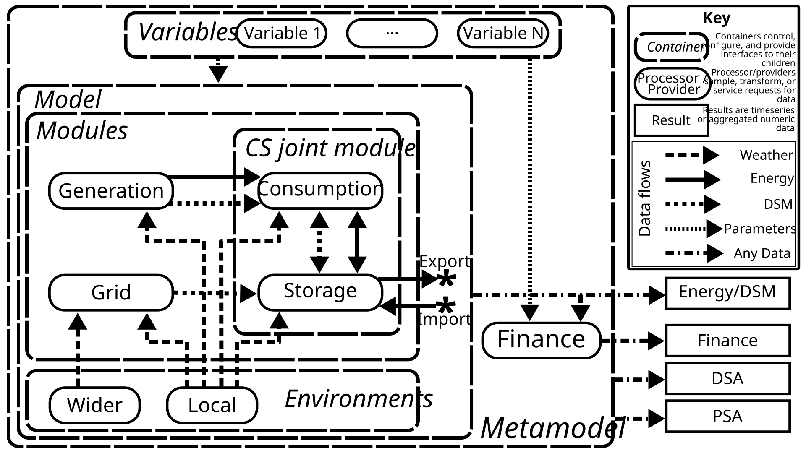
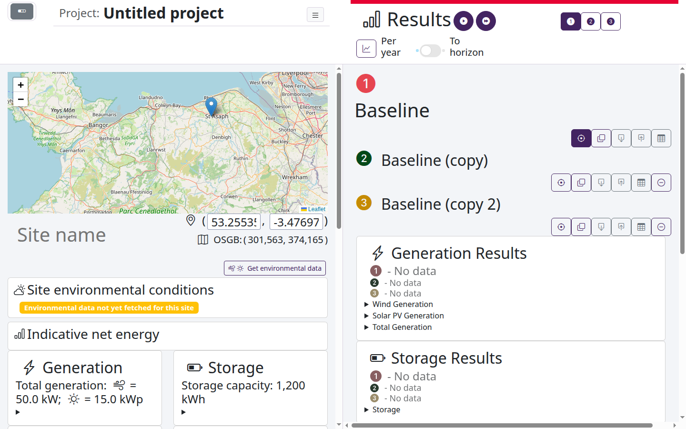

# The NewSEGS Model

Modelling software for grid-connected private-wire electrical networks incorporating on-site generation and storage.

**[Documentation](https://robyoung88.github.io/ca-wu-newsegs-model/)** · [Install](docs/getting-started/install.md) · [User guide](docs/user-guide.md) · [Modelling principles](docs/modelling/index.md) · [Contributing](docs/development.md)

## Purpose

The North Wales Social Housing Newbuild on-Site Energy Generation and Storage (NewSEGS) project aims to identify and optimise opportunities for community-level self-supply of renewable energy in newbuild social housing in North Wales.

This software models a site's electrical energy generation, consumption, storage and grid exchange, then values the results from the perspective of the system owner. It allows you to compare scheme configurations, and test how sensitive they are to the value of uncertain inputs.

## Origin

The NewSEGS model builds on the work of Dr David Sprake and is developed at Wrexham University.

Dr Sprake's PhD investigated the cost-effectiveness of self-supply of locally generated renewable electricity over the scale of a housing estate. There is space within legislation governing the supply of electricity to households within Great Britain to allow a limited quantity of electricity to be sold by an "unlicensed" supplier, meaning that a party can act as an aggregator of electrical generation within an electrical network (e.g. of rooftop solar) and could sell that electricity directly to customers on that same network, or store and then sell that electricity, without having to levy all components that make up the price of residential electricity supply in Great Britain; in particular the policy, transmission and distribution costs. By avoiding these costs, there is potential for locally generated electricity to be sold at a rate which undercuts commercial supply, despite there being limited economy of scale for community-scale generation; i.e. the generator can recoup costs at a rate greater than the price of wholesale electricity whilst the cost to the customer is still lower, as there are substantial fractions of the commercial supply cost excluded from the prices.

This scenario has particular application to Registered Social Landlords, whose properties may have generation (particularly rooftop solar) installed, but the benefit to the residents is limited as they must time their electrical use to coincide with generation, and the benefit to the RSL is extremely limited, as the Smart Export Guarantee export price scheme as implemented by GB electricity suppliers does not offer good terms to parties who are not also customers of their electricity; the RSL cannot legally have direct influence over the choice of supplier of their tenant, and so this situation is rarely true. Therefore the overall price paid to the RSL for exported electricity is negligible.

If, however, the RSL were to offer a party the opportunity to lease generation space on the roofs of a newbuild estate, with room set aside for a Battery-Energy Storage System (BESS), then a not-for-profit Energy Service Company (ESCo) could take control of supplying the entire site using these assets on a private wire network. Provided that customers could request for pass-through access to the open market, the ESCo could act as a single customer to commercial supply, and in turn sell electricity to the residents at a reduced rate, under the assumption that much of the electricity generated on site would be consumed on site. The diversity of load over a single feeder would allow for better generation/load matching than behind the meter of a single residence, and addition of a BESS further allows for control of the energy passing over the site boundary.

To explore this possibility, ClwydAlyn Housing Association engaged with Wrexham Univerity in a Welsh Government supported SMART partnership. This software, permitted to be released under an open-source license, was one of the resultant artifacts of this partnership.

## Modelling principles



A **metamodel** holds one complete configuration of a scheme:

- An **energy model** runs over a common time period, so that correlated weather affects generation, demand and prices together. Its modules run in order: **grid**, then **generation**, then **consumption and storage**, which are evaluated together because they form a feedback loop.
- **Environment servers** supply the local and wider weather data the modules need.
- A **finance model** turns the energy results into costs, benefits, net present value and payback. It can be swapped without re-running the energy model.
- **Variables** describe the uncertainty in each parameter, and drive deterministic (DSA) and probabilistic (PSA) sensitivity analysis.

The grid is treated as an infinite bus: it can absorb or supply any quantity of energy.

Read more: [modelling principles](docs/modelling/index.md) · [financial perspectives](docs/modelling/finance.md)

## Install and run

Docker is the quickest way to run the complete app, including its dispatcher and maintenance services:

```bash
docker compose up --build --detach
```

Then open <http://localhost:8050>.

To run for development, with live code and debug tools:

```bash
docker compose -f docker-compose.yml -f docker-compose.dev.yml up --build
```

Read more, including running without Docker, environment variables and storage locations: [installation guide](docs/getting-started/install.md)

## Use the app

1. **Choose a model type** on the model selection page.
2. **Configure a scheme** on the site configuration page.
3. **Compare configurations** by adding more to the project.
4. **Optimise generation and storage** by checking the sensitivity of the site to differing quantities and searching for the highest value solution on the DSA page.
5. **Test sensitivity** on the DSA and PSA pages.



Read more: [user guide](docs/user-guide.md)

## Develop

### Set up

```bash
conda env create -f conda-lock.yml
conda activate ca-wu-newsegs-mod
pip install -r requirements-pip.txt -r requirements-test.txt
python -m pytest test/unit_tests
```

The full suite includes the slower DSA and PSA tests. See [the CI command](.github/workflows/unit-tests.yml) for the subset run on pull requests.

### Pull requests and CI

- Branch from `development` and open the pull request against it.
- Use a [Conventional Commit](https://www.conventionalcommits.org/) title (`feat: ...`, `fix: ...`). It sets the next version.
- Releases promote `development` to `canary`, then `canary` to `main`.

**If the default model artifact check fails**, your change altered the generated models. Download `generated-default-model-artifacts` from the failed workflow run, update the matching files in `data/`, and push.

Read more: [development and releases](docs/development.md)

### Documentation

The documentation is built with [MkDocs](https://www.mkdocs.org) from `docs/` and the docstrings in `src/`.

```bash
pip install -r requirements-docs.txt
mkdocs serve   # live preview at http://127.0.0.1:8000
```

It is published to GitHub Pages from `main`. The app also serves it at `/documentation/`, once built with `mkdocs build`.

Read more: [docstring conventions](docs/docstrings.md)

### Develop a model

A model type has two parts, both discovered as plugins:

1. A **framework plugin**: a factory in `src/newsegsmodelframework/plugins/projects/`, decorated with `@register_project_factory`, returning a configured `NewsegsProject`.
2. An **app plugin**: a directory in `src/newsegsmodelapp/plugins/models/` providing inputs, results and processing. Anything you omit falls back to the default.

Then add the model type to `AVAILABLE_MODELS` in `src/app.py`, and add its button to the model selection page.

Read more: [framework plugins](docs/framework/plugins.md) · [adding a model type to the app](docs/app/plugins.md#adding-a-model-type)

### Develop the app

The app is a multi-page [Dash](https://dash.plotly.com) application. `src/app.py` is the entry point. Requests go through a dispatcher to background workers, which write to a SQLite database and a results store.

- Pages live in `src/newsegsmodelapp/plugins/pages/`.
- Reusable components, layouts and callbacks live in `src/newsegsmodelapp/components/`.
- The dispatcher, workers and database layer live in `src/newsegsmodelapp/backend/`.

Read more: [architecture](docs/architecture.md) · [application overview](docs/app/index.md) · [app plugins](docs/app/plugins.md)

### Profile

```bash
pip install viztracer
python -m viztracer --log_async --min_duration 500 -o trace.json src/app.py
```

Open `trace.json` in [Perfetto](https://ui.perfetto.dev/) or [speedscope](https://www.speedscope.app/).

Read more: [profiling](docs/development.md#profiling)

## Licence

Copyright (c) 2026 Wrexham University. Available under the [MIT License](LICENCE).
