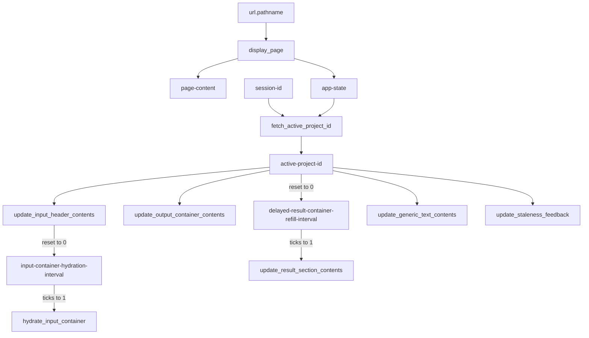
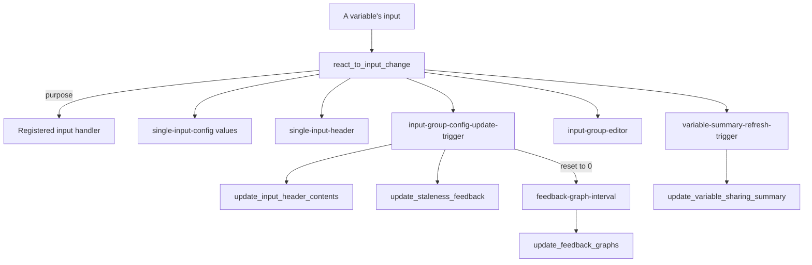
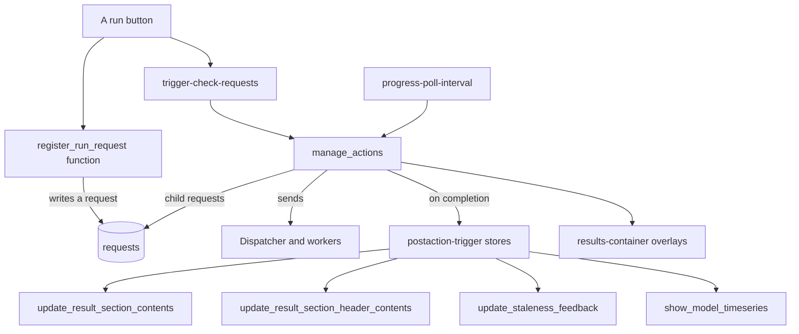

# Callbacks

The app is a multi-page [Plotly Dash](https://dash.plotly.com/) app. Its pages are built from containers that callbacks
fill, so that one layout serves every model type. This page describes the stores that pages share, the ids that
callbacks match, and the chains of callbacks that draw the inputs and results and run the model.

Callbacks are bound once, by `create_app` in `src/app.py`:

| Function | Module | Callbacks |
|---|---|---|
| `add_display_callbacks` | `app.py` | Session, routing, the active project |
| `add_navigation_callbacks` | `components/navigation.py` | The navigation drawer |
| `add_input_container_callbacks` | `components/callbacks/input_container_callbacks.py` | Input headers and containers, input changes, text fields, feedback graphs, sharing summaries |
| `add_project_selector_callbacks` | `components/project_selector.py` | Creating, loading, renaming and deleting projects and snapshots |
| `add_site_selector_callbacks` | `components/map.py` | The site map and its inputs |
| `add_environment_feedback_callbacks` | `components/callbacks/environment_feedback_callbacks.py` | The environmental conditions of a site |
| `add_configuration_selector_callbacks` | `components/configuration_selector.py` | Focusing, renaming, duplicating, removing, uploading and downloading configurations |
| `add_action_callbacks` | `components/callbacks/action_callbacks.py` | Starting and monitoring runs, cancelling jobs |
| `add_result_container_callbacks` | `components/callbacks/result_container_callbacks.py` | Result containers, headers and tables, and whether results are out of date |
| `add_result_timeseries_callbacks` | `components/callbacks/timeseries_callbacks.py` | The timeseries of the focussed configuration |
| `Page.attach_callbacks` | each page in `plugins/pages` | The page's own callbacks, e.g. its run buttons and dialogs |

`app.validation_layout` holds the layout of every page, so Dash accepts callbacks for components that only some pages
have.

## Shared stores

`serve_layout` (in `app.py`) puts these components in the root of the layout, outside `page-content`, so they persist
across pages:

| Id | Kind | Holds | Set by |
|---|---|---|---|
| `url` | `dcc.Location` | The path, `/{model_type}/{page}` | The navigation buttons |
| `page-content` | `html.Div` | The page | `display_page` |
| `session-id` | `Store` (local) | The browser's session id, `sess-<uuid>` | `initialise_session_id`, on first visit |
| `app-state` | `Store` (session) | JSON: `current_page`, `session_id` and `model_type` | `display_page`, only when it changes |
| `active-project-id` | `Store` (session) | The id of the session's project | `fetch_active_project_id`, and callbacks that change the project (see below) |
| `trigger-check-requests` | `Store` | A timestamp | The run buttons, after writing a request |
| `staleness-update-trigger` | `Store` | A timestamp | Callbacks that may change whether results are out of date outside the input triggers, e.g. a change of site |
| `ongoing-actions`, `failed-actions` | `Store` | The ids of the runs under way; the messages of failed runs | `manage_actions` |
| `progress-poll-interval` | `Interval` | Polls the runs | Enabled by `manage_actions` while runs are under way |
| `delayed-result-container-refill-interval` | `Interval` | Refills the result tables after a change of project | Reset to 0 when the project changes; ticks to 1 |
| `feedback-graph-interval` | `Interval` | Redraws the feedback graphs | Reset to 0 when an input changes |
| `postaction-trigger` stores | `Store` | The requests completed, as JSON | `manage_actions` (see [Runs](#runs-and-post-actions)) |

`layout-update-trigger` and `trigger-check-stale` are also in the layout, and are inputs of several callbacks, but no
callback sets them, so they fire only when the app loads. `configuration-update-trigger`
(`components.CONFIGURATION_UPDATE_TRIGGER_ID`) is in the layout but used by no callback.

## Loading a page

1. **Routing.** `display_page` reads the model type from the first part of the path, and the page from the rest.
   `/` and `/model-selection`, and any path whose model type isn't in `AVAILABLE_MODELS`, show the model selection
   page. The page is looked up in `PAGE_REGISTER` and its `layout` is called with the layout configuration registered
   for the page and model type (see [Plugins](plugins.md#pages)). `app-state` is written only when it changes, so that
   its listeners don't fire for nothing.
2. **The project.** `fetch_active_project_id` asks the project provider for the session's project of the model type
   (`get_session_project_id`) and writes it to `active-project-id`. A session with no project of the model type, such
   as a new browser, gets the latest project of the type, or a new one if there is none.
3. **Filling the page.** A change of `active-project-id` starts the callbacks that fill the containers:
   - the input section headers, which also reset each input container's hydration interval to 0. When it ticks to 1,
     `hydrate_input_container` builds the container's inputs. Building them on the tick, not on the reset, means
     each container is built once;
   - the result containers, and, through the refill interval, the result tables;
   - the generic text fields, such as the project name in a header;
   - the indicators of out-of-date results.

### `active-project-id` as a refresh signal

Callbacks that change the project, but not which project is active, write the same id back to `active-project-id` to
redraw the page. Renaming, duplicating, focusing, removing and uploading configurations do this, as do renaming a
project and creating or deleting snapshots. `update_output_container_contents` skips the containers already drawn for
the project when the project is its only trigger, using their `data-rendered-project-id`.

## Component ids

Callbacks match components by pattern-matching (dictionary) ids. The ids that are shared between components and
callbacks are:

### Input containers

| Type | Id keys | Component |
|---|---|---|
| `input-container` | `supersection`, `section` | The container of a section's inputs, filled by its input container content creator |
| `input-section-header` | `supersection`, `section` | The section's header, filled by its header content creator, if it has one |
| `input-container-hydration-interval` | `supersection`, `section` | The interval which builds the container |
| `input-card-label` | `supersection`, `section` | The label of a section's card |

The `supersection` is the page or group of inputs (`deterministic`, `dsa`, `psa`, `optim`), and the `section` the
group of variables, e.g. `gen_input`.

### Variable inputs

Every component of a variable's input has an id made by `VariableInstanceParameterComponentID`
(`components/variable_identification.py`), with the keys:

| Key | Meaning |
|---|---|
| `type` | What the component is (below) |
| `supersection` | The page or group of inputs |
| `purpose` | What it changes, e.g. `parameter`, `bound-lower`, `value-reset`; the input handlers are registered by purpose |
| `section`, `key`, `subindex` | The variable: together they make its varid, `{section}.{key}.{subindex}` |
| `parameter_index`, `vector_location` | Which parameter of the variable, and the position within an array parameter |

The ids of the other groups in a group editor (`group-value-input`) add `var_uid`, the id of their Variable.

| Type | Component |
|---|---|
| `single-input-config` | An input of a parameter, bound or setting |
| `input-dropdown`, `input-toggle`, `input-action-button`, `input-summary` | Other inputs of a variable: dropdowns, toggles, buttons (e.g. reset), and the summary of a row whose clicks open its editor |
| `group-value-input`, `group-move-request` | The group editor's inputs of other groups, and its moves between groups |
| `single-input-header` | The header of a variable's input |
| `input-group-editor` | The container of a row's editor, built when the row is opened |
| `input-group-config-update-trigger` | A store set when the variable's configuration is saved |
| `variable-summary-refresh-trigger` | A store set to redraw the variable's sharing summary |

### Results

Result components have ids with the keys `type`, `purpose`, `supersection`, `section`, `key` and `subindex`:

| Type | Purpose | Component |
|---|---|---|
| `result-container` | `container` | A result, filled by its result container content creator, keyed by `key` and `section` |
| `result-section-header` | `header` | A result section's header |
| `result-table` | `container` | A table or figure drawn from a stored table (`section` is `tabledraw`, `key` the table) |
| `result-table-option` | the option, e.g. `statistic` | An option of a table, which redraws it |
| `postaction-trigger` | `trigger` | A store set when a request completes (`supersection` is `global`, `section` is `run`, `postprocess` or `tabledraw`, and `key` the request type) |

The containers of a group of results, made by `layouts.result_group_containers.create_results_container`, have ids
`{'type': ..., 'section': ..., 'supersection': ...}` with the types `results-container` (whose `data-status` shows
whether runs are under way), `results-content`, `results-overlay-text`, `results-overlay-subtext` and
`results-progress-bar`.

### Other ids

| Id | Component |
|---|---|
| `{'type': 'generic_text', 'section': ..., 'key': ...}` | A text field filled from the project, by `key`: `project-name`, `site-name` or `configuration-name` |
| `{'type': 'config-name-input' \| 'config-focus-btn' \| 'config-hdrfocus-btn' \| 'config-dup-btn' \| 'config-remove-btn' \| 'config-download-btn' \| 'config-upload', 'index': n}` | The configuration selector's inputs and buttons, for configuration `n` |
| `{'type': 'action-button-ps', 'key': ...}` | The project selector's buttons |
| `{'type': 'annual-horizon-toggle', 'page': ...}` | The toggle between results per year and to the horizon |
| `{'type': 'feedback-graph', 'section': ..., 'key': ...}` | A feedback graph, drawn by the artist registered for its `key` |

## Changing an input

`react_to_input_change` receives almost every change to a variable's input. Its inputs and outputs use `MATCH` on
`section`, `key` and `subindex`, so each call is for one variable. It handles the DSA bounds (`bound-lower`,
`bound-upper`), the optimisation bounds and plot resolution (`plot-intervals`), the DSA bound type (`dsaboundtype`)
and the DSA selection (`dsa-active`) itself. It passes every other purpose to the handler registered for it, looked up
by purpose, component type and model type (see [Input handlers](plugins.md#input-handlers)). The registered handlers
include `parameter` (a value), `value-reset`, `value-set-default`, `toggle-optim-active`, `psa-active`,
`psa-settings`, `group-editor-toggle` (opening a row) and the group editors' `group-value`, `move` and
`group-dsa...` purposes.

The callback ignores a call in which several of its inputs fire. That happens only when new components are drawn,
not when the user changes something.

A handler returns its updates in `return_dict`. Setting the `trigger_data` of the variable's
`input-group-config-update-trigger` stores signals that the variable was saved: the section header is redrawn, the
indicators of out-of-date results are updated, and the feedback graphs are redrawn. Setting `summary_refresh` redraws
the variable's sharing summary.

## Runs and post-actions

1. A run button's callback (in the page's `attach_callbacks`) calls the function registered with
   `register_run_request` for the action, which writes a request to the database. It then sets
   `trigger-check-requests`.
2. `manage_actions` runs on `trigger-check-requests` and on each tick of `progress-poll-interval`. It sends new
   requests to the dispatcher, reads the progress of the runs under way, and shows it in the `results-container`
   overlays. It retries failed runs, up to their limit, and reports those that can't be retried in `failed-actions`.
3. When a run completes, `manage_actions` appends the request to the `postaction-trigger` store for its request type,
   and to those of any other tables it drew (the `also_draws` of `register_table_draw`: the table draw of a
   whole-project DSA or PSA also draws each configuration's tables). It creates the requests of its [post-actions](plugins.md#processes) (postprocessing, then table drawing) and starts
   them. It disables the poll interval once no request is active. A request just created has no run until a worker
   claims it, so the interval keeps going, and the results show as calculating, until the last post-action completes.
4. The `postaction-trigger` stores are inputs of the callbacks that show results.
   `update_result_section_contents` redraws the tables that match the trigger, using the table getters registered
   for the model type. It skips a table whose rendered project, table revision and annual/horizon state are
   unchanged, unless its options changed or, for a table with a getter, the focussed configuration changed or the
   table's own trigger fired.
   `update_result_figure_contents` empties a figure when its getter has no result.

`cancel_job` cancels every request when a `cancel-job-button` is clicked.

## Callbacks with several inputs

Several inputs of a callback can fire in the same call, such as a post-action trigger and the refill interval after a
run. `ctx.triggered_id` and `callback_utils.get_triggered_value()` give only the first, so callbacks with several
inputs use the helpers in `callback_utils` to consider every trigger (see
[Components](components.md#callbacks-with-several-inputs)).

## Testing callbacks

`test/unit_tests/test_app_callbacks/dash_dispatch.py` posts requests to `/_dash-update-component` through the Flask
test client, as the browser does, so that Dash itself resolves the callback, its pattern matching and `ctx`. See
[Adding a test of an input handler](../development.md#adding-a-test-of-an-input-handler).
