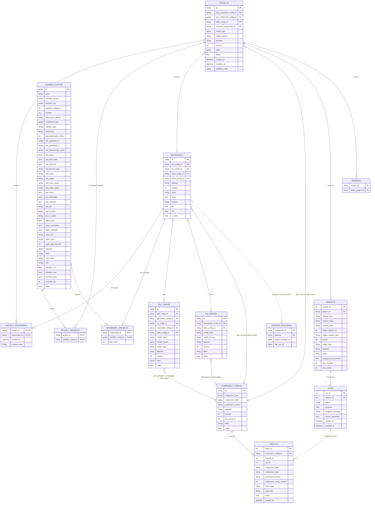
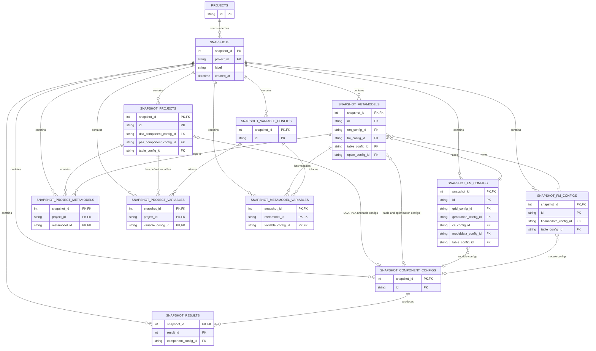

# Application database

The `newsegsmodelapp` Dash app stores configurations, results metadata, job requests and
sessions in a SQLite database. The tables are defined with SQLAlchemy in
`newsegsmodelapp.backend.db.db_tables` and migrated with Alembic (`alembic/versions`).

Large result payloads are not stored in the database: the `results` table records the
`result_file` in the results store, and the database holds only the metadata needed to find it.

## Live tables

Identifiers for variables and components are text (`prefix + uuid`), not integers. The
`component_configs` table holds the configuration of every individual model module (grid,
generation, consumption/storage, tables...). The `em_configs`, `fm_configs`, `metamodels` and
`projects` tables compose these into the structure described in
[Metamodel](../framework/metamodel.md).

### Notes

* Dotted lines are relationships without a foreign key.
* `metamodel_variables.key_order` is the position of the variable's key (`{section}.{key}`, without the subindex)
  among the metamodel's variables, so that they are loaded in the order they were saved. It is null for rows saved
  before it was recorded, whose order is taken from the metamodel's payload.
* `variable_configs` holds the settings of a variable for each analysis in columns of their own (`dsa_*`, `psa_*`,
  `optim_*`), with its parameterisation (`parameterisation_index`, `raw_parameter_*`), the limits and formatting of
  its input (`interface_*`, `formatter_dp`, `unit`, `icon_name`), and the full variable in `payload`.
* `process_staleness` has no foreign key, so that deleting a metamodel is never blocked by its
  staleness rows. It records, per metamodel and per process (see `db_staleness.PROCESSES`), when
  the inputs relevant to the process last changed and when the last completed run began. A
  process is stale when its inputs changed after its last run started.
* `metamodels.optim_config_id` is the `OptimComponent` holding the method and statistic of
  optimisation. It is null for metamodels saved before it existed; they are given the default
  component when loaded. The bounds of optimisation are held by each variable, in the
  `optim_min`, `optim_max` and `optim_plot_intervals` columns of `variable_configs`.
* `variable_configs.component_version` is the version of the `Variable` class that saved the
  row, null if it was saved before versions were recorded. As with the other components, the
  payload records the version too, and a payload newer than the app supports is rejected.
* The times of `runs` are in UTC, without a timezone: `created_at` is filled in by SQLite, and `modified_at` by the
  app (`db_tables.utc_now`). The dispatcher marks a run as failed once `modified_at` is older than
  `DEAD_CALCULATION_INTERVAL_SECONDS`, and pruning compares both with a cutoff in UTC, so both work whatever the host's
  timezone. `projects.modified_at` is still in local time.
* `requests` are created by the front end (from the actions in the app) and picked up by the
  dispatcher; each request is executed as one or more `runs` by a worker. The run carries the
  progress and cancellation flag that the front end polls.
* `results.request_id` and `results.run_id` are for convenience and are deliberately not foreign
  keys.
* Users, groups and read/write access to projects are planned (see the `TODO` in
  `db_tables.projects`) but are not yet implemented.

## Snapshot tables

A snapshot freezes a copy of a project - its metamodels, models, components, variables and
results - so that it can be restored later. Each live table `x` has a `snapshot_x` twin
whose primary key is extended with `snapshot_id`, and whose remaining columns are cloned from
the live table (without its foreign keys). Foreign keys between snapshot tables are composite,
so they refer to the rows *within the same snapshot*.

`snapshots.project_id` refers to the live `projects` table, so a project can be reverted to any
of its snapshots.
