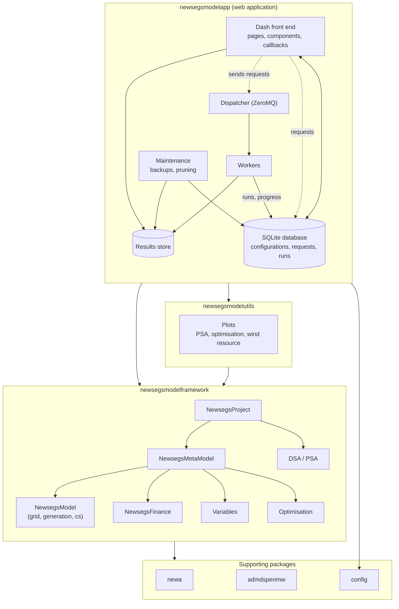

# Architecture

## The framework (`newsegsmodelframework`)

The framework knows nothing about the web application, and draws no figures: it uses neither Dash nor any
plotting library. It provides:

* [`core`](framework/core.md) - the base classes: revision-tracked, serialisable
  *components* (`NewsegsComponent`), `NewsegsModule`, time spans, locations and the
  environment servers that supply weather data.
* The model [modules](framework/modules.md) (`newsegsgrid`, `newsegsgeneration`,
  `newsegscs`), which are assembled by a [model](framework/model.md) (`newsegsmodel`).
* [Finance](framework/finance.md) (`newsegsfinance`) which values the output of a model.
* [Variables](framework/variable.md) (`newsegsvariable`) which statistically characterise
  parameters of the model and finance.
* The [metamodel and project](framework/metamodel.md) (`newsegsmetamodel`, `newsegsproject`),
  which bind models, finance and variables together and put them in a state ready to run.
* [Sensitivity analysis, optimisation and statistics](framework/stats-sensitivity.md)
  (`newsegssensitivity`, `newsegsstats`).
* [Utilities](framework/util.md) (`util`).
* [Plugins](framework/plugins.md) which register the *project types* the framework offers.

Every object that is configured by the user is a `NewsegsComponent` or `DataWithRevision`, and
can therefore be serialised to and from a dictionary. The app stores these dictionaries in its
database (see [Database](app/database.md)).

## The plotting utilities (`newsegsmodelutils`)

The [plotting utilities](support/utils.md) draw figures from the data of the framework, such as the plots of a PSA, for the
app (and for scripts). They use the framework, but the framework does not use them.

## The application (`newsegsmodelapp`)

The application consists of:

* a Dash **front end** (`app.py`, `newsegsmodelapp.components`), a multi-page app whose pages
  and model-specific contents are supplied by [plugins](app/plugins.md);
* a **backend** ([`newsegsmodelapp.backend`](app/backend.md)) containing the database layer,
  a ZeroMQ dispatcher, the workers that perform runs and the maintenance jobs;
* a SQLite [database](app/database.md) holding configurations, snapshots, requests, runs and
  sessions. Result data are written to a results store on disk, and the database refers to them.

The front end never runs a model itself. User actions create **requests** in the database.
The front end's action manager sends new requests to the dispatcher, which hands them to
**workers**. Each worker records progress in a **run**, and
writes results to the results store. The front end polls the database for progress and loads
results from the results store when they are complete. Each completed run may trigger
*postprocessing* and *table-drawing* requests (see [Application plugins](app/plugins.md)).

These processes are started as separate services in `docker-compose.yml`
(`dash-app`, `zmq-dispatcher`, `maintenance-cron`).

## Supporting packages

* `newa` - retrieves wind resource data from the New European Wind Atlas.
* `admdspenmw` - After Diversity Maximum Demand calculation.
* `config` - the `settings` object ([Dynaconf](https://www.dynaconf.com) reading `src/settings.toml`).

## Extension points

Neither the framework nor the application hard-code the model that they run. Instead:

| To add... | Extend | Described in |
|---|---|---|
| A new model type (set of modules, finance and default variables) | `newsegsmodelframework.plugins.projects` | [Framework plugins](framework/plugins.md) |
| A new module, finance or variable class | `newsegsmodelframework.core.constructors` | [Framework plugins](framework/plugins.md) |
| A new page in the web app | `newsegsmodelapp.plugins.pages` | [Application plugins](app/plugins.md) |
| The inputs, results and processing for a model type | `newsegsmodelapp.plugins.models` | [Application plugins](app/plugins.md) |
