# Core components API Reference

Base classes and supporting types shared by the rest of the framework. The names imported by
`newsegsmodelframework.core` itself are those used elsewhere in the framework and the app; everything
else is in the modules documented below.

::: newsegsmodelframework.core

## Components and revision tracking

#### NewsegsComponent

Base class of a NewSEGS (meta)model component.
    
Provides common functionality for model components including unique identification serialization/deserialization, and configuration synchronization checks.

##### Implementation

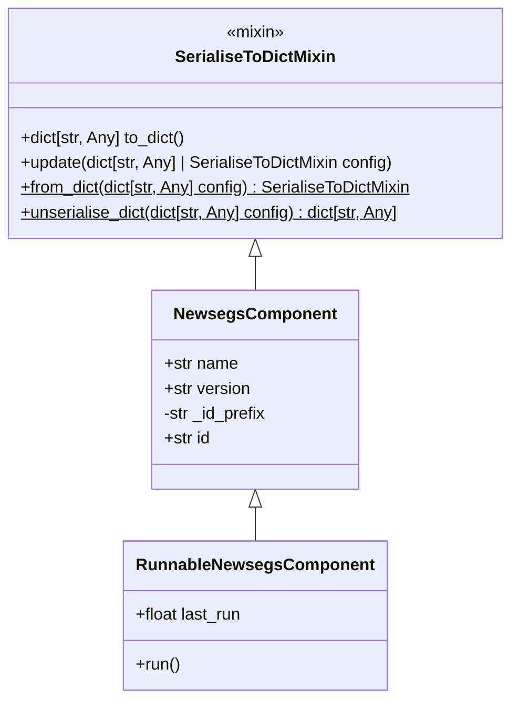
*NewsegsComponent UML diagram*

::: newsegsmodelframework.core.newsegscomponent

::: newsegsmodelframework.core.lightweightnewsegscomponent

::: newsegsmodelframework.core.trackeddata

## Serialisation and constructors

#### SerialiseToDictMixin

Mixin to provide a JSON-friendly dictionary representation for objects.

Classes that inherit this mixin gain a `to_dict()` method which returns a dictionary containing the object's class name and constructor class (under keys 'class' and 'constructor_class') plus a representation of the instance attributes found in ``self.__dict__``.

Attributes listed in ``_excluded_attributes`` are omitted from the dictionary. Subclasses should set ``_constructor_class`` to a string identifier used by the reconstruction mechanism (e.g. find_constructor).

##### Implementation

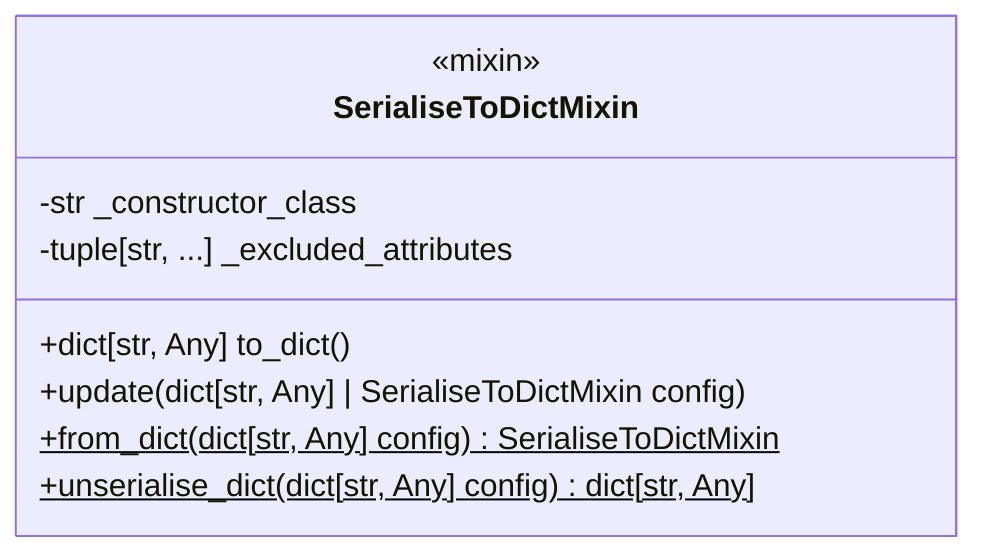
*SerialiseToDictMixin UML diagram*

::: newsegsmodelframework.core.serialisation

::: newsegsmodelframework.core.serialisedtrackeddata

::: newsegsmodelframework.core.constructors
    options:
        show_submodules: true

## Modules, models and results

#### NewsegsModule

A [`NewsegsComponent`](#newsegscomponent) which exists under a [NewsegsModel](#newsegsmodelinterface)

Subclasses should implement the abstract run() method to perform a computation over a given [TimeSpan](#timespan) and return a [NewsegsModuleResult](#newsegsmoduleresult).

This class provides common plumbing including tracking the associated NewsegsModelInterface instance, a "dirty" flag that indicates whether the module configuration has changed since the last run, and recording the last run time.

##### Implementation

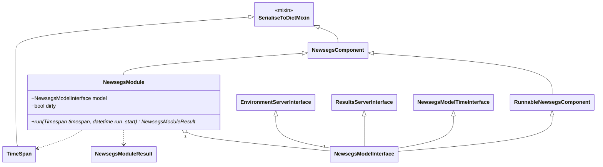
*NewsegsModule UML diagram*

::: newsegsmodelframework.core.newsegsmodule

#### NewsegsModuleResult

An abstract class for holding Module results. Results are held as two timeseries arrays, one of which representing `meter`s (i.e. measureable energy transfer) and the other as `dsm` (demand-side management), which may hold arbitrary data used for control and monitoring of the NewSEGS system. The [TimeSpan](#timespan) over which the results are applicable is also stored.

##### Implementation

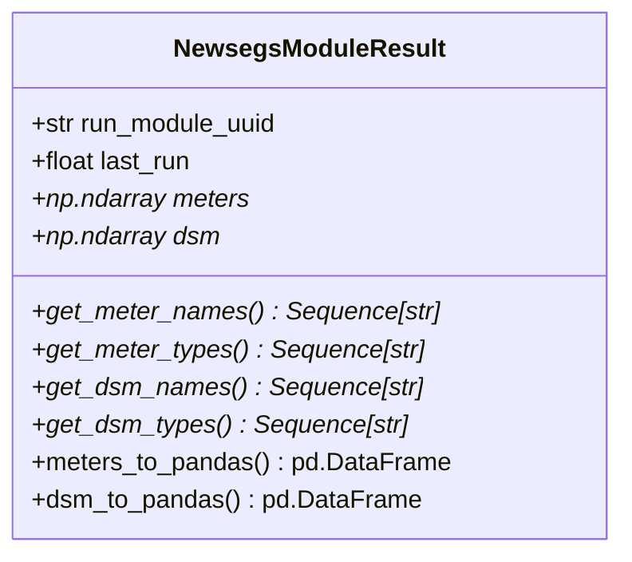
*NewsegsModuleResult UML diagram*

::: newsegsmodelframework.core.newsegsmoduleresult

#### NewsegsModelInterface

The `NewsegsModelInterface` is a collection of abstract classes establishing the contracts for a `NewsegsModel` such that other components can anticipate the behaviour of a Model without having to import the base class itself, avoiding circular imports for Model children.

##### Implementation

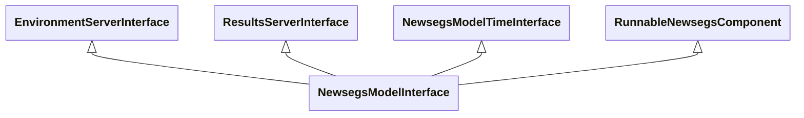
*NewsegsModelInterface UML diagram*

::: newsegsmodelframework.core.newsegsmodelinterface

#### NewsegsFinanceInterface

The `NewsegsFinanceInterface` is a [NewsegsComponent](#newsegscomponent) which is a collection of abstract classes establishing the contracts for a `NewsegsFinance` such that other components can anticipate the behaviour of a Finance without having to import the base class itself, avoiding circular imports.

##### Implementation

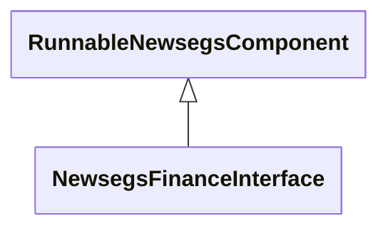
*NewsegsFinanceInterface UML diagram*

::: newsegsmodelframework.core.newsegsfinanceinterface

#### NewsegsModelTimeInterface

Classes implementing `NewsegsModelTimeInterface` provide access to the default [timestep](#timespan) of a Model.

##### Implementation

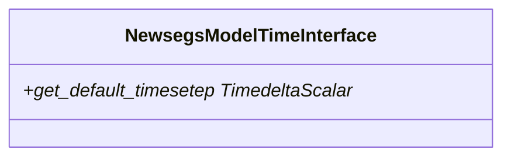
*NewsegsModelTimeInterface UML diagram*

::: newsegsmodelframework.core.newsegsmodeltimeinterface

#### ResultServerInterface

Classes implementing `ResultServerInterface` provide access to the [results](#newsegsmoduleresult) of the three Modules of a Model, i.e. Grid, Generation and Consumption/Storage.

##### Implementation

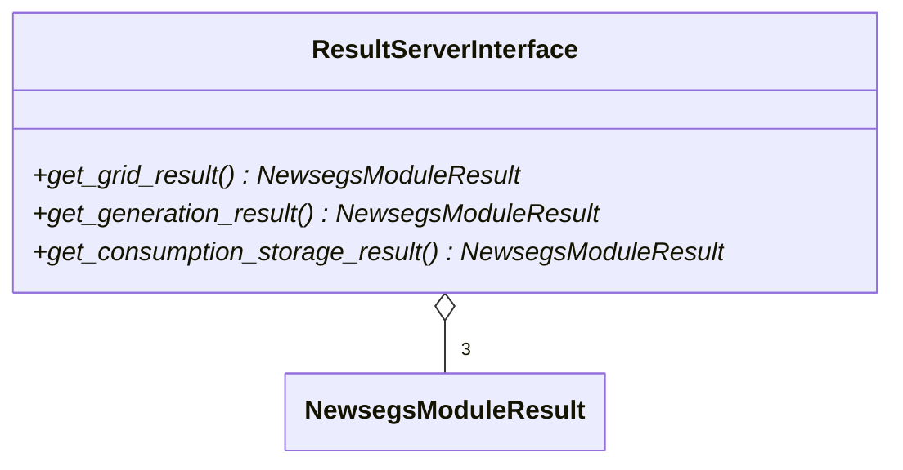
*ResultServerInterface UML diagram*

::: newsegsmodelframework.core.resultsserverinterface

::: newsegsmodelframework.core.environmentserverinterface

::: newsegsmodelframework.core.newsegsresultprovider

## Time, location and environment

### Timespan

As the Model has been developed for use in North Wales, the assumed timezone for all unspecified data is UTC. Corrections for daylight saving time with respect to active hours of consumption are made, as appropriate, within the Model.

A generic timespan is represented by a "start" and "end" time in utc, implying a positive "delta" over this span.

The Model is currently limited to operation in fixed-interval discrete time; this is represented by a "regular" timespan, an extension to the concept of a timespan which includes a timestep. Such a timespan includes an integer number of "interval"s, and an integer number of "node"s equal to the number of intervals + 1. If the timespan does not divide exactly into the timestep, the number of intervals will be rounded down and a sequence starting at the timespan's "start" and striding by "timestep" will finish prior to the "end" of the timespan, at a datetime provided by `end_timeseries`.

In order to service long time horizons or shift Model predictions to future dates, it is necessary to timeshift and potentially recycle reference timeseries data. Such timeshifting should be undertaken sensibly (i.e. respecting the season for weather data, and both the season and day of week / holidays for consumption data - for this reason, consumption data is generally abstracted to expected values per season-day rather than using timeseries directly), but when it is, an "offset regular timespan" is used to represent the relationship between the datetimes in the reference timeseries (the "remote" datetimes) and those it provides values for (the "local" datetimes).

When specifying the relationship between the local and the remote times (`set_offset`), any datetimes can be used, allowing alignment of a timeseries that starts in July with a model timespan that starts in January, for instance. In general, the local start will be a datetime within the first year of the Model timespan, whilst the remote start will be a corresponding year day datetime within the first year of the timeseries timespan.

A `normalise_index` method performs the conversion between the local regular timeseries index and the remote index.

When an offset regular timespan reaches the end of its reference period, it is necessary to wrap its indices to cycle through the timeseries again. The timeseries data may be *prospective* (i.e. values at a node are valid for the next time interval) or *retrospective* (i.e. values at a node represent what has occurred over the previous time interval). Both forms of data are present in the sources for the model; e.g. prospective timeseries may occur in spot prices fixed for the upcoming half-hour of consumption, whilst environmental data may represent an aggregate over the previous hour and so be retrospective. A timespan with start and end at the same time and day over (a) year(s) time apart has one more node than there are intervals in the same timespan, and so it must be decided to which timeseries value the first or the last node correspond, with the understanding that the data for this node are likely to be nullified as they have no corresponding interval over which to occur (exceptions may exist, such as capital expenditure datetimes, and these are appropriately guarded against). A `wrap_right` property is used to specify that the last interval in the timeseries should be recycled for the value at node 0; should this be set to `False`, the last node will recycle that at timeseries interval 0.

#### Implementation

Internal representation of datetimes and time deltas in most cases uses `pandas` (`pd`) types; e.g. `pd.Timestamp` for point datetimes and `pd.Timedelta` for time deltas. Timezone is generally assumed to be UTC unless otherwise specified.

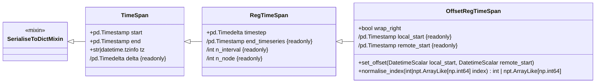
*UML diagram for TimeSpan*

::: newsegsmodelframework.core.timespan
    options:
        show_submodules: true

### Location

In specifying a location, the specificity required is dependent upon the use case. In the simplest case, a location is specified as a point upon the Earth's surface in WGS84 decimal latitude/longitude form.

For measures such as wind speed, the location is necessarily above the surface and is specified with an additional `height_agl` (Above Ground Level in metres) field.

For insolation, it is also necessary to know the azimuth and pitch of the plane receiving solar flux. The former is described in degrees clockwise from north, whilst the latter is described in degrees upwards from horizontal (i.e. 90 degrees is a vertical plane).

#### Implementation

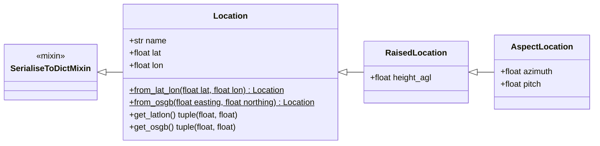
*UML diagram for Location*

::: newsegsmodelframework.core.location
    options:
        show_submodules: true

#### Environment Servers

##### NewsegsLocalEnvironment

Abstract base class for site-specific environmental data providers.

This class defines the interface for local environmental data services that provide wind speeds, air density, solar flux, and temperature information for NewSEGS models.

##### NewsegsWiderEnvironment

##### Implementation

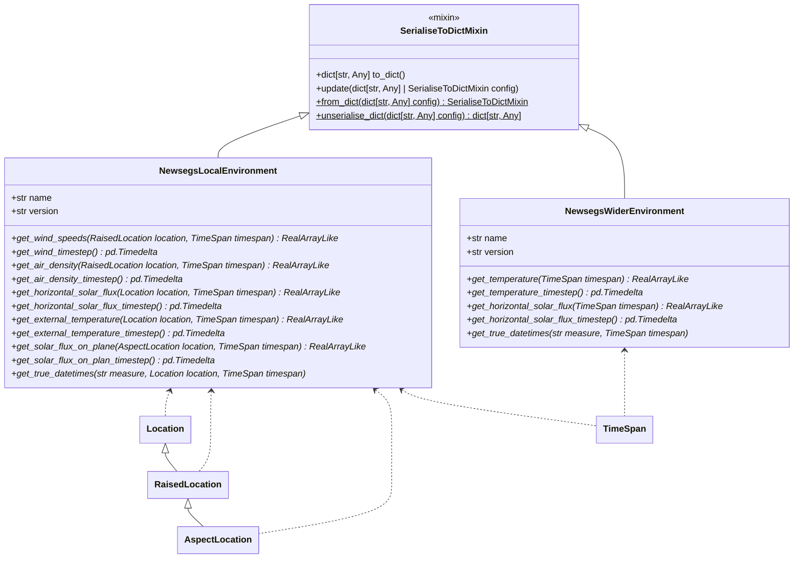
*Environment server UML diagram*

#### EnvironmentServerInterface

Classes implementing `EnvironmentServerInterface` provide access to a [`NewsegsLocalEnvironment`](#newsegslocalenvironment) server via a property `.local_env` and a [`NewsegsWiderEnvironment`](#newsegswiderenvironment) server via a property `.wider_env`

##### Implementation

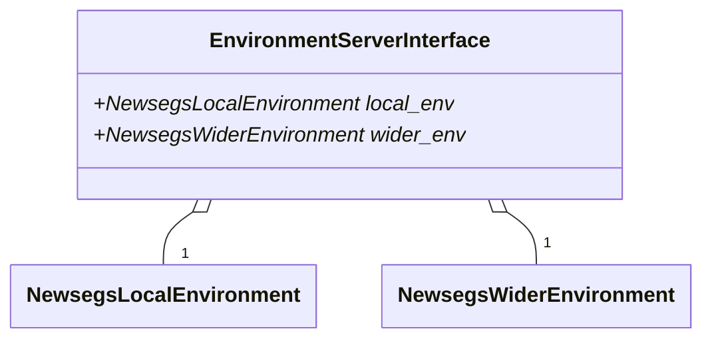
*Environment Server Interface UML diagram*

::: newsegsmodelframework.core.environment
    options:
        show_submodules: true

## Generators

::: newsegsmodelframework.core.generation
    options:
        show_submodules: true
