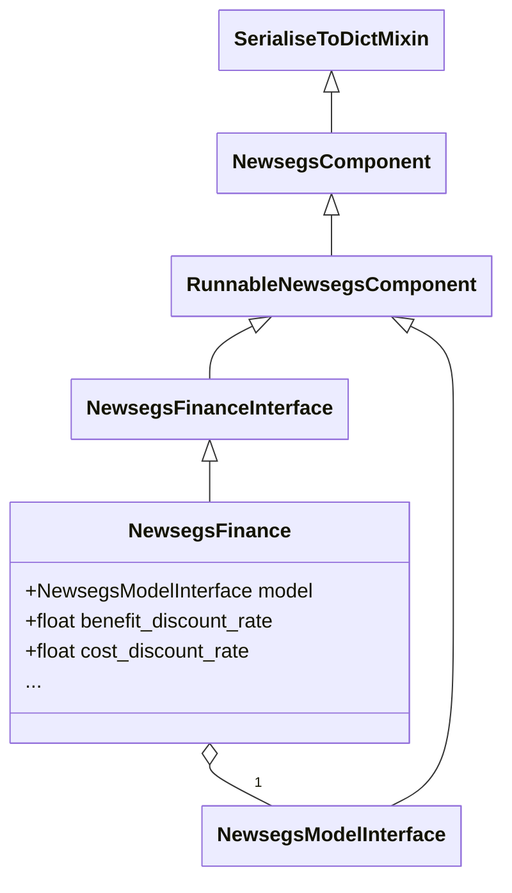

# Finance Model API Reference

### NewsegsFinance

A `NewsegsFinance` implements and extends the [NewsegsFinanceInterface](core.md#newsegsfinanceinterface).

#### Implementation

::: newsegsmodelframework.newsegsfinance
    options:
        show_submodules: true
