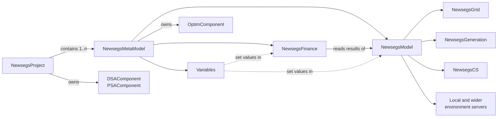

# Framework overview

`newsegsmodelframework` is the modelling library that underlies the NewSEGS software. It can be used
on its own (for example in scripts or notebooks) and has no dependency on the web application.

| Package | Contents | Reference |
|---|---|---|
| `core` | Base classes, serialisation, revision tracking, time, location and environment | [Core components](core.md) |
| `newsegsgrid`, `newsegsgeneration`, `newsegscs` | Model modules - grid, generation, consumption and storage | [Modules](modules.md) |
| `newsegsmodel` | Assembles the modules into an energy model | [Model](model.md) |
| `newsegsfinance` | Finance model and finance data | [Finance](finance.md) |
| `newsegsvariable` | Variables - statistical characterisations of parameters | [Variable](variable.md) |
| `newsegsmetamodel`, `newsegsproject` | Bind model, finance and variables; collect metamodels | [Metamodel and Project](metamodel.md) |
| `newsegssensitivity`, `newsegsstats` | DSA, PSA, optimisation and statistics | [Statistics and Sensitivity](stats-sensitivity.md) |
| `util` | Helper functions | [Utilities](util.md) |
| `plugins` | Registry of project types | [Plugins](plugins.md) |
| `constants` | Framework and model constants | |

Implementations specific to the Sprake energy model are prefixed `sprake` (e.g. `SprakeModel`,
`SprakeGeneration`, `SprakeCS`, `SprakeFinance`) and sit alongside the abstract `Newsegs...`
base classes.

## Lightweight classes

For most of these classes there is a `Lightweight...` counterpart (`LightweightNewsegsModel`,
`LightweightNewsegsMetaModel`, `LightweightNewsegsProject`, `LightweightVariable`,
`LightweightNewsegsFinance`) holding only the information needed to describe and display the
object, without the machinery needed to run it. The web app uses these where it does not need to
run a model, which keeps page loads fast.
