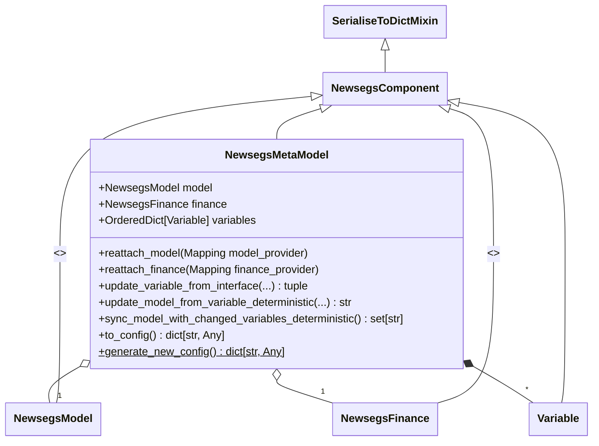

# Metamodel and Project API Reference

### Metamodel

The NewSEGS Metamodel (Metamodel) is a container for a "configuration" of Energy Model, Finance Model, and the [Variables](variable.md#variable) which parameterise them. It provides methods for serialisation and deserialisation, including or excluding its associated Model and Finance instances.

A reduced quantity of information capable of identifying the metamodel and its key characteristics can be contained in a Python dictionary referred to as a `config`. This contains the name of the Metamodel and unique identifiers for itself, its associated Model, and its associated Finance.

#### Provisions

The Metamodel provides methods for the following:

- Parameter synchronisation
    - Updating a Metamodel held Variable given its identifying characteristics and new value
    - Updating a Model or Finance parameter with the deterministic value of a held Variable.
    - Updating the Model or Finance parameters where the deterministic value of the associated Variables have changed.
- Config
    - Generation of a new `config`
    - Production of a `config` correct for the current instance.

::: newsegsmodelframework.newsegsmetamodel
    options:
        show_root_heading: false
        members_order: source
        show_submodules: true

## Project

A project holds one or more metamodels together with the default variables, and the sensitivity
analysis configuration, that apply to them. See [Framework plugins](plugins.md) for how projects
are created.

### NewsegsMetaModel

A `NewsegsMetaModel` is a [`NewsegsComponent`](core.md#newsegscomponent) which acts as a container for a [`NewsegsModel`](model.md#newsegsmodel), an associated [`NewsegsFinance`](finance.md#newsegsfinance), and a collection of [`Variable`](variable.md#variable)s which correspond to parameters within the Model and Finance components.

Unlike its contained values, the `NewsegsMetaModel` class is not abstract, but serves as a concrete implementation of its purpose.

When serialising to dict, its associated Model and Finance are excluded; when unserialising, these objects must be reattached by providing the Metamodel with a mapping that can return the appropriate Model or Finance instance when provided with its id.

#### Implementation

::: newsegsmodelframework.newsegsproject
    options:
        show_submodules: true
