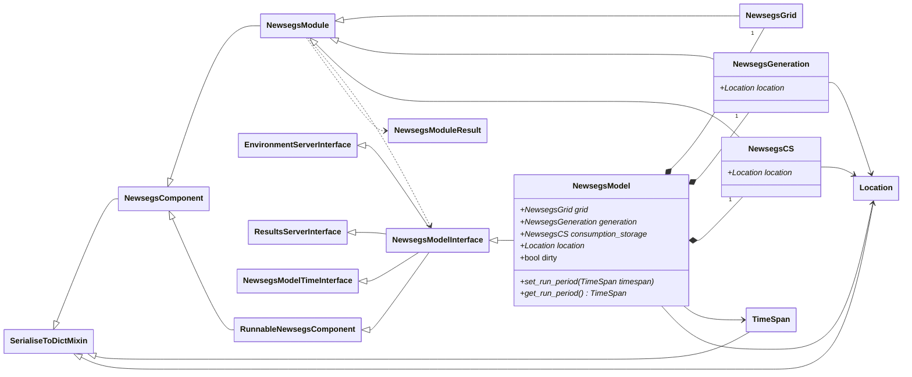

# Energy Model API Reference

### NewsegsModel

A `NewsegsModel` implements and extends the [NewsegsModelInterface](core.md#newsegsmodelinterface). It manages three [NewsegsModule](core.md#newsegsmodule)s - the Grid, the Generation, and the Consumption / Storage module. 

#### Implementation

::: newsegsmodelframework.newsegsmodel
    options:
        show_submodules: true
