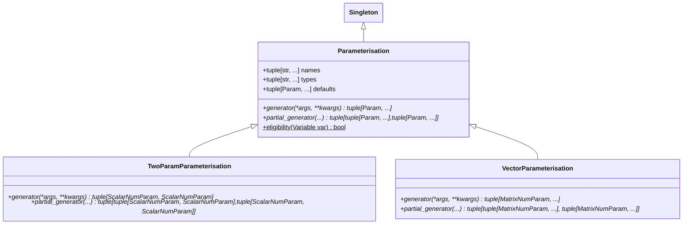
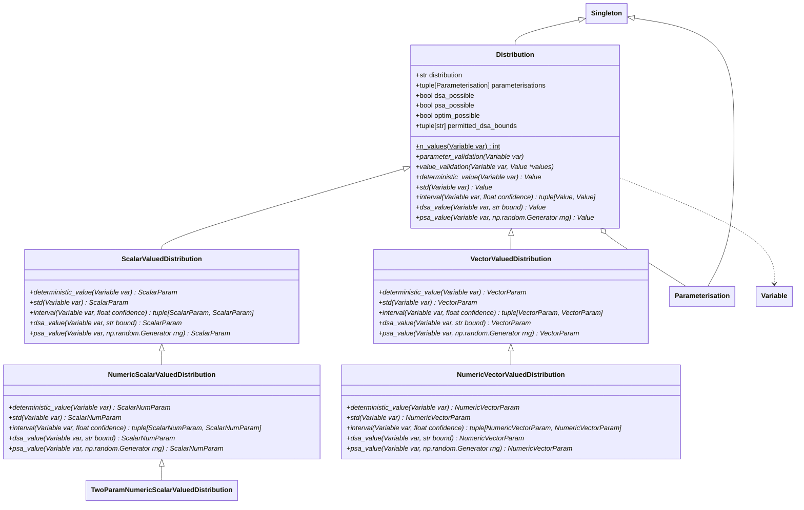
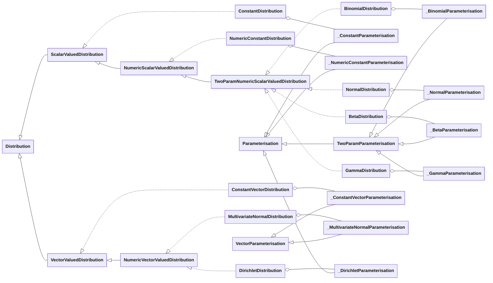
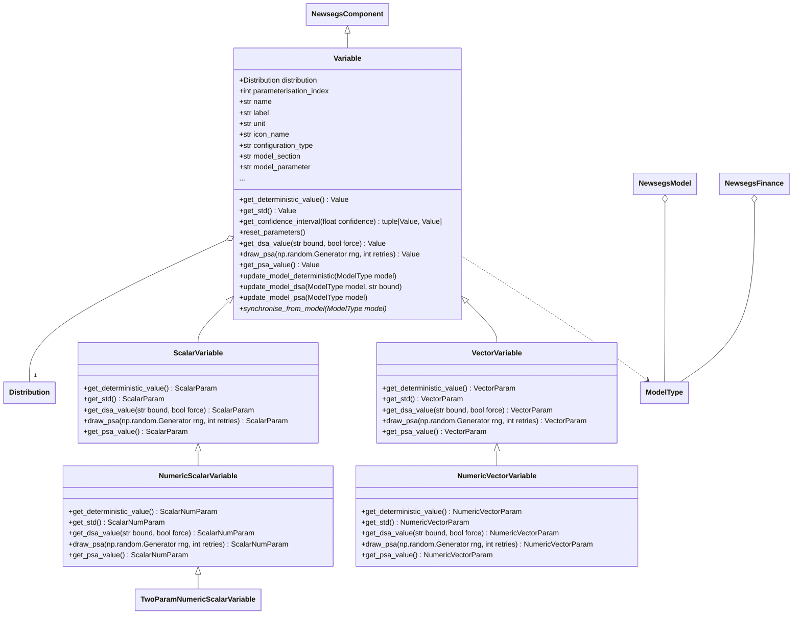
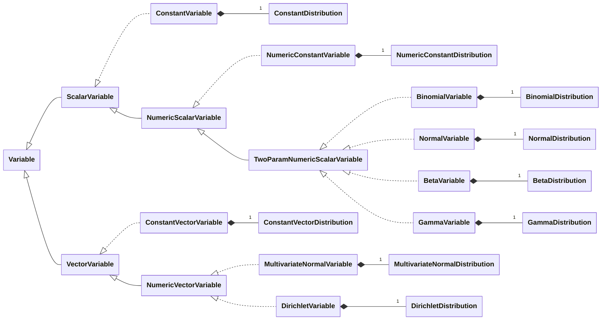

# Variable API Reference

### Variable

A Variable is a container for data associated with an Energy Model or Finance Model parameter. Principally, they exist to hold data related to sensitivity analysis of a Metamodel i.e. whilst the Model and Finance hold current parameters for analysis, the Variables list holds the metaparameters which indicate how those parameters are to be varied in Deterministic (One-Way) Sensitivity Analysis and Probabilistic Sensitivity Analysis.

> Glossary:
> - Parameter: An item of data which influences the outcome(s) of a model (e.g. fixed cost per kW wind generation installed).
> - Value: A number, string, or vector of numbers or strings which can be used as a Parameter of a Model or Finance (e.g. £1,000 / kW).
> - Variable: A container holding data allowing for the production of Values used to parameterise a Model (e.g. an object identifying itself as associated with the parameter "fixed per-unit cost of wind" within an Energy Model, where that parameter is uncertain with a probability density described by a Gamma distribution with mean £1,000 / kW and standard deviation of £100 / kW).
> - Metaparameter: An item of data used to parameterise a Variable (e.g. the standard deviation of the fixed per-unit cost of wind).
> - Metavalue: A number, string, or vector of number or strings which can be used as a Metaparameter of a Variable (e.g. £100 / kW).

 The data a Variable carries serves the following purposes:

1. Naming and presenting the Variable (i.e. a `name`, a `unit`, an `icon_name`).
1. Hierarchically identifying the associated parameter for presentation in a User Interface:
    - `configuration_type`: `'model'` or `'finance'`
    - `interface_section`: e.g. `'gen_input'` for generation configuration input
    - `interface_key`: e.g. `'pv_capacity'` for the value in kWp of PV installed
    - `interface_subindex`: e.g. `0` to indicate this is the value for the 0-indexed PV array aspect, which might be 180° (south) whilst index `1` might be an array at 90° (east).
1. Hierarchically identifying the associated parameter within the Model or Finance object:
    - `configuration_type`: `'model'` or `'finance'` (shared with the Interface purpose)
    - `model_section`: e.g. `'mod_gen'` for the generation Module of a Model.
    - `model_parameter`: e.g. `'pv_capacity'` for the value in kWp of PV installed.
1. Identifying the statistical distribution used for its Value(s).
1. Storing Metaparameters to provide a fixed (deterministic / mean values) Value to its associated Parameter.
1. Storing Metaparameters for use in DSA (i.e. whether the Parameter is to be varied, and the values to which to set the associated Parameter).
1. Storing Metaparameters for use in PSA (i.e. whether the Parameter is to be varied, and the distribution characteristics of the Parameter).

#### Parameterisation

A Parameterisation is a way of describing a Distribution; a single Distribution may have multiple Parameterisations. Parameterisations convert Parameters into canonical form for use by a Distribution using `generator` functions.

#### Implementation

*Parameterisation UML Diagram*

*Distribution UML Diagram*

*Concrete Distribution classes - UML diagram*

*Variable UML Diagram*

*Concrete Variable classes - UML diagram*

::: newsegsmodelframework.newsegsvariable
    options:
        show_submodules: true
