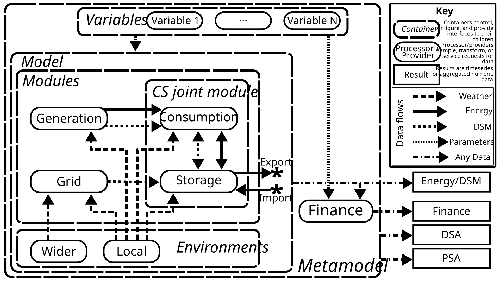

# The NewSEGS Model

## Introduction 
The North Wales Social Housing Newbuild on-Site Energy Generation and Storage (NewSEGS) project aims to identify and optimise opportunities for self-supply of renewable energy in newbuild social housing in North Wales.

The NewSEGS-modelling project builds on the work of Dr David Sprake to produce estimates of the financial performance of a local energy system.

## Model Concept

### Model Diagram

*NewsegsMetamodel conceptual diagram*
