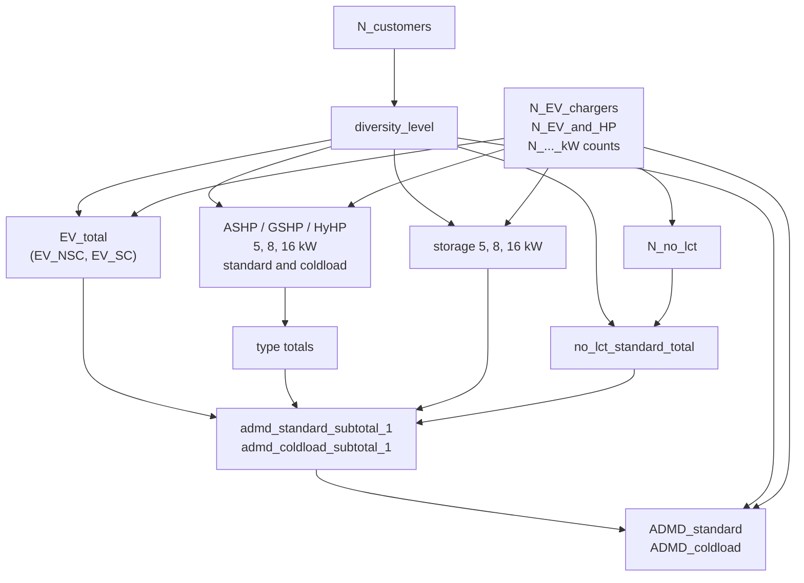

# After Diversity Maximum Demand Calculator

The `admdspenmw` package estimates the **After Diversity Maximum Demand (ADMD)** of a group of
homes on a feeder - the peak demand the group places on the network once the fact that
individual peaks do not coincide is allowed for. It is a Python version of the *Public ADMD
Calculator V1.1* spreadsheet of SP Energy Networks (SP Manweb), extended with electric vehicle
chargers, heat pumps and storage heating. The app uses it in the postprocessing of Sprake
consumption results (`calculate_sprake_admd`) to estimate the ADMD of a site.

There are two results: `ADMD_standard` for standard (peak) conditions, and `ADMD_coldload` for
*cold load pickup* - the demand when supply is restored after an interruption and heating
loads run together.

## Method

For a number of customers, the calculator chooses a *diversity level* (1, 5, 10, 15, 20, 25, 50,
100 customers - the more customers, the more diversity). For each group of households - those with
an EV charger, each type and size of heat pump, storage heating, or no low carbon technology (LCT) -
a tabulated per-household demand at that level (`src/admdspenmw/data/admd_lookups.csv`, from the
spreadsheet) is multiplied by the number of households in the group. The groups are summed, and
a correction is subtracted for households with both an EV charger and a heat pump, which were
counted in both groups.

The functions of `admdspenmw.admd` are the nodes of a [Hamilton](https://hamilton.apache.org)
dataflow: each function is named for the value it calculates and takes the values it depends on
as parameters. The inputs are the numbers of customers, EV chargers and systems of each size.
`newsegsmodelframework.util.admd_helpers` builds the driver, and `model_config` holds the defaults.

## Sizing systems from dwellings

Systems are sized by dwelling in the NewSEGS software (`ASHP_count` and its siblings):
apartments and homes of fewer than 3 bedrooms use 5 kW, 3-4 bedrooms 8 kW and
5 or more bedrooms 16 kW. This follows the spreadsheet's *Assumptions* sheet.

## Differences from the spreadsheet

* The battery storage reduction (40% of peak if the battery is at least three times the ADMD in
  kWh) is not implemented; the spreadsheet's calculation of it refers to a missing cell.
* The spreadsheet's three input columns (bedroom bands, each with one average system size) are
  replaced by counts of systems per size.
* More than 101 customers use diversity level 200 (values equal to level 100), where the
  spreadsheet gives `N/A`.
* Results are totals for the feeder, not an average per household.

The full list of assumptions and the functions are documented below.

::: admdspenmw
    options:
        show_submodules: true
