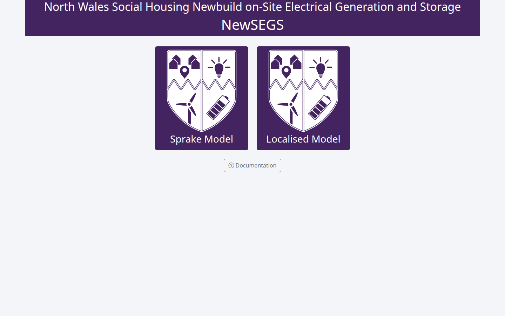
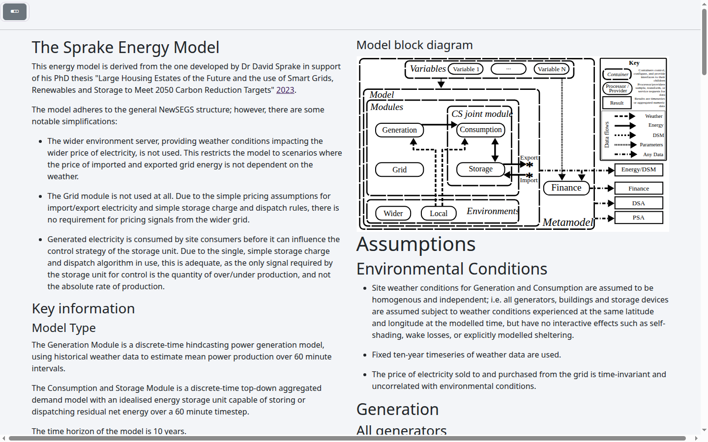
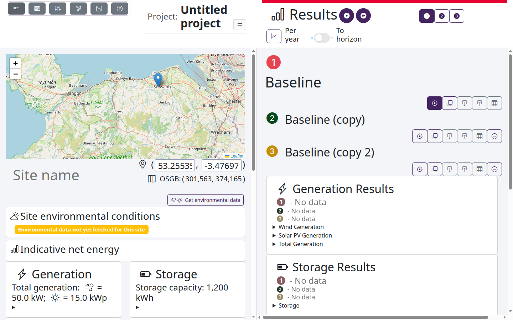
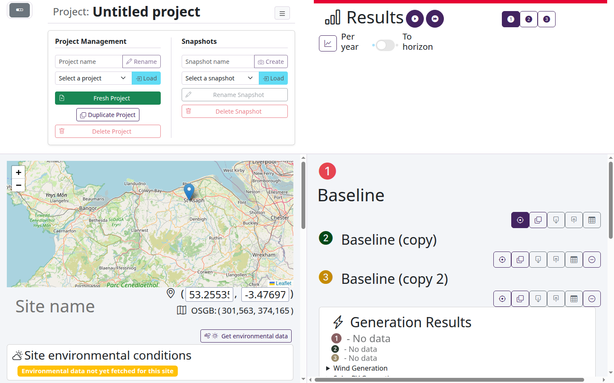
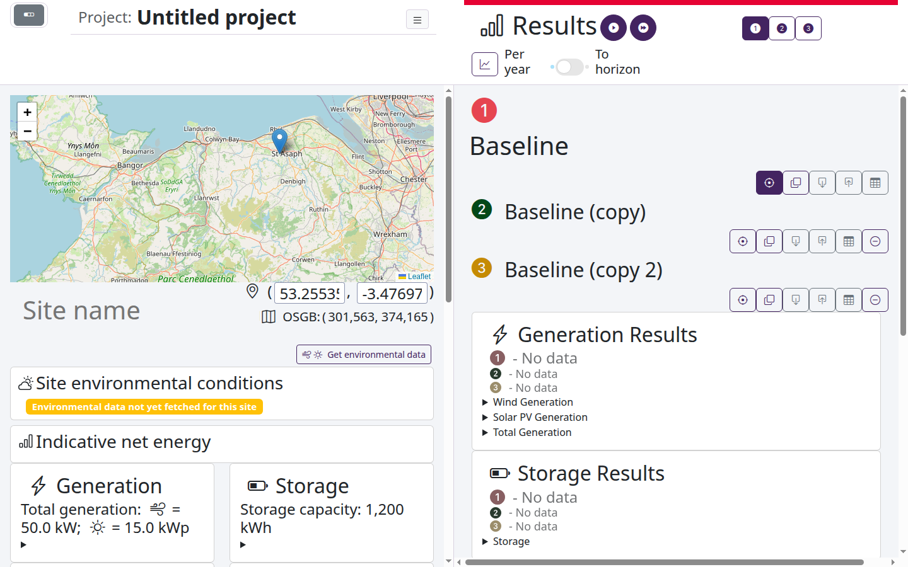
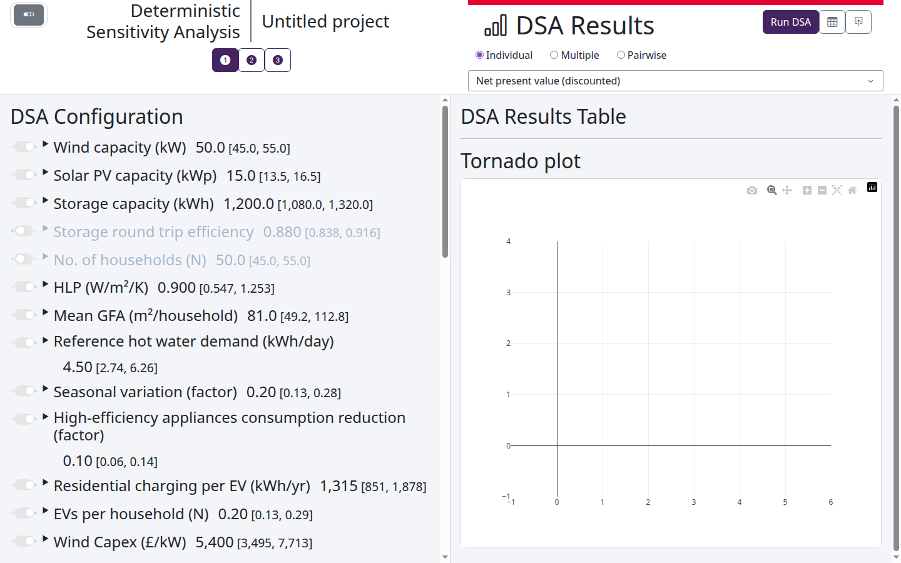
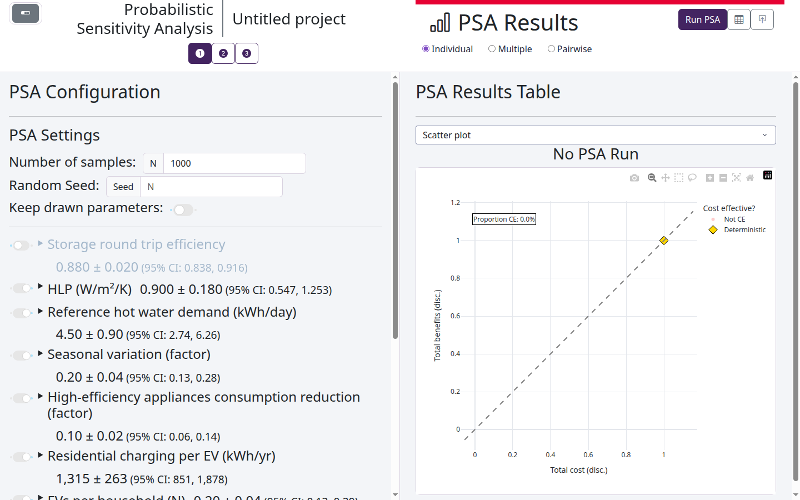

# User Guide

## Introduction

This guide gives an overview of the interactions and capabilities of the NewSEGS modelling framework as accessed via the web app. If you are looking for how to create your own models or run calculations in python, start with [Modelling principles](modelling/index.md).

The guide will take you through the following actions:

 - Starting the app.
 - Selecting a model type.
 - Setting up a project.
 - Setting up a configuration.
 - Running deterministic analyses.
 - Optimising
 - Running deterministic sensitivity analyses (DSA).
 - Running probabilistic sensitivity analyses (PSA).

### Key terms

| Term | Meaning |
|---|---|
| **Model type** | The energy model used, e.g. the Sprake model or the localised model. Each model type has its own projects. |
| **Project** | A set of configurations to compare. The app keeps your project between visits. |
| **Configuration** | One option for a site: its generation, storage, consumption and costs. Each configuration has a number and a colour, used in every input, header and plot. The first, *Baseline*, can't be moved or removed. |
| **Snapshot** | A saved copy of a project, which can be restored as a new project. |
| **Deterministic run** | A run of a configuration with the central value of every input. |
| **DSA** | Deterministic sensitivity analysis: runs with each selected input at its lower and upper bound in turn, to show which inputs matter most. |
| **PSA** | Probabilistic sensitivity analysis: many runs with the inputs drawn from their distributions, to show the spread of the results. |

### Starting the app

The app runs in a web browser. See [Install and run](getting-started/install.md) to start it, with Docker or without.
Once it is running, open `http://localhost:8050`.

### Selecting a model type

The first page offers the model types. Click one to open its landing page. The *Documentation* button opens this
documentation.

The landing page describes the model: its structure, assumptions and the data it uses.

#### Moving between pages

The button at the top left of each page opens the navigation bar. Its buttons go to the landing page, the site
configuration, the sensitivity analysis (DSA and optimisation) and the probabilistic analysis (PSA) pages, and to this
documentation.

### Setting up a project

The app opens your last project of the model type, or a new project if you have none. Its name is shown at the top
of each page. The button beside the name opens the project controls:

- **Project management:** rename the project, load another, start a fresh project, duplicate this one, or delete it.
- **Snapshots:** save a snapshot of the project, and load, rename or delete snapshots. Loading a snapshot restores it
  as a new project.

Give each project a meaningful name: new projects are called *Untitled project*.

### Setting up a configuration

The **site configuration** page holds the inputs of the focussed configuration, on the left, and the results of
every configuration, on the right.

- **Configurations:** the list under *Results* shows every configuration of the project. Its buttons
  focus a configuration (so its inputs are shown), duplicate it, download or upload it as a file, download its
  results, and remove it. A copy is named after its source, e.g. *Baseline (copy)*; type a meaningful name in its
  name box.
- **Site:** for the localised model, choose the site on the map or by its latitude and longitude, and give it a name.
  *Get environmental data* fetches the weather data of the site and shows its wind and solar conditions. The first
  fetch for a site can take several minutes.
- **Inputs:** each section of inputs (generation, storage, consumption, costs...) can be opened to change its values.
  When configurations share an input, opening its summary shows the groups of configurations with the same value, and
  lets you move configurations between them.

### Running deterministic analyses

The run buttons beside *Results* run the focussed configuration, or every configuration. Progress is shown over the
results while the run is under way. When it completes, the results of each configuration are shown in its colour:
generation, storage, consumption and finance, per year or to the horizon of the model (the toggle under *Results*).

Results go out of date when an input they depend on changes; the header of each result shows when they are.

### Optimising the configuration

The **sensitivity analysis** page also holds the optimisation. Choose the inputs to optimise and their bounds, and the
statistic to optimise, then start the optimisation. When it finishes, the app reports what the optimisation achieved
and, if it found an improvement, applies it to the configuration.

### Running deterministic sensitivity analyses (DSA)

On the **sensitivity analysis** page, choose the inputs to vary with their toggles, and their lower and upper bounds.
*Run DSA* runs the focussed configuration, or every configuration, with each input at its bounds in turn.

The results are shown as a table and a tornado plot of the chosen statistic. *Multiple* compares the configurations,
and *Pairwise* compares one configuration with a reference.

### Running probabilistic sensitivity analyses (PSA)

On the **probabilistic analysis** page, set the number of samples and the random seed, and choose the inputs to draw,
with their distributions. *Run PSA* runs the configurations for each draw.

The results are shown as plots, chosen from the list above them, such as a scatter of costs and benefits, and as
tables. As for the DSA, *Multiple* and *Pairwise* compare configurations.
